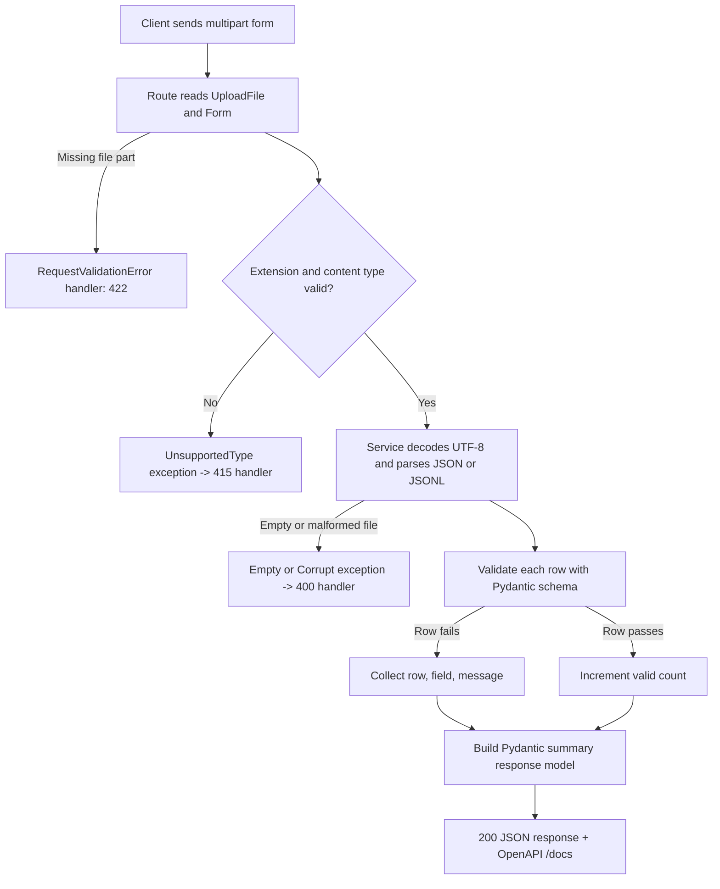

# Concept Kit: Upload, Validate, Report

**Project:** Dataset Readiness API
**Sprint:** A1

Stage 4 compact lesson. It teaches every mechanism Sprint A1 needs so you can design, build, test, and document the slice without researching outside the Learning OS.

Each mechanism below is taught as a paired unit: the six-step Why-Chain, when-to-use decision rule, parameter table, standalone runnable worked example, and pitfalls to watch.

Your A1 code, `README.md`, `ARCHITECTURE.md`, `DECISIONS.md`, and `docs/demo.md` stay yours. Every worked example here uses a **Book Catalog** domain, never your LLM dataset validator.

Verified on:

- Python 3.12.4
- FastAPI 0.162.0
- Pydantic 2.13.4
- Starlette 1.10.0
- httpx 0.28.1
- python-multipart 0.0.19

This kit connects to what you already know:

- custom exceptions and `try/except`
- generators from Lesson 24
- `pytest` fixtures and assertions
- Python type hints

---

## Table of contents

1. [Objective and success check](#1-objective-and-success-check)
2. [Mental model](#2-mental-model)
3. [Why-Chain, decision rules, and worked examples by mechanism](#3-why-chain-decision-rules-and-worked-examples-by-mechanism)
   - [3.1 Pydantic declarative constraints with Field and ConfigDict](#31-pydantic-declarative-constraints-with-field-and-configdict)
   - [3.2 Custom validators vs declarative constraints](#32-custom-validators-vs-declarative-constraints)
   - [3.3 Flattening ValidationError into per-row reports](#33-flattening-validationerror-into-per-row-reports)
   - [3.4 FastAPI custom exception configuration with multiple handlers](#34-fastapi-custom-exception-configuration-with-multiple-handlers)
   - [3.5 FastAPI multipart form endpoints with UploadFile, File, and Form](#35-fastapi-multipart-form-endpoints-with-uploadfile-file-and-form)
   - [3.6 Parsing uploaded bytes for JSON array and JSONL](#36-parsing-uploaded-bytes-for-json-array-and-jsonl)
   - [3.7 OpenAPI contract with response_model and responses](#37-openapi-contract-with-response_model-and-responses)
   - [3.8 Boundary testing with TestClient, clean imports, and environment config](#38-boundary-testing-with-testclient-clean-imports-and-environment-config)
   - [3.9 Architectural decisions that belong to you](#39-architectural-decisions-that-belong-to-you)
4. [Worked examples map](#4-worked-examples-map)
5. [Pitfalls](#5-pitfalls)
6. [Practice and retrieval](#6-practice-and-retrieval)
7. [Sprint slice and exercise coverage matrix](#7-sprint-slice-and-exercise-coverage-matrix)

---

## 1. Objective and success check

**Intent:** Build and verify a multipart file-validation endpoint that parses JSON or JSONL uploads, validates every row with Pydantic v2 constraints and validators, collects structured per-row errors, and maps domain exceptions to honest HTTP status codes with an accurate OpenAPI contract.

You are done with this kit when:

- you answer the 5 retrieval questions in section 6 without notes
- all 20 tests across `test_e1.py`, `test_e2.py`, `test_m1.py`, and `test_h1.py` pass in `A1-practice`
- you update your A1 slice plan and `DECISIONS.md` using the decision rules in section 3

---

## 2. Mental model



How to read this diagram:

- Only the **HTTP boundary** (`main.py` route and registered exception handlers) knows about HTTP status codes, `UploadFile`, or `JSONResponse`.
- The **service layer** speaks pure Python: raw bytes and filename go in, and either a Pydantic summary model returns or a plain domain exception is raised.

---

## 3. Why-Chain, decision rules, and worked examples by mechanism

Sprint A1 combines eight distinct mechanisms. Each subsection below pairs the six-step Why-Chain, decision rule, parameter table, standalone runnable worked example, and specific pitfalls to watch.

---

### 3.1 Pydantic declarative constraints with Field and ConfigDict

#### Goal
Declare record schemas with type bounds, length constraints, regex patterns, and strict coercion controls that run in Rust and publish directly to OpenAPI `/docs`.

#### Why-Chain

1. **Problem:** Raw dictionaries parsed from JSON can hold missing keys, empty strings, negative numbers, wrong types (`5` instead of `"5"`), or malformed codes.
2. **Why the old way falls short:** Writing manual `if not isinstance(x, str) or len(x) < 1:` branches for every key scatters rules across functions, stops at the first `raise`, and never appears in OpenAPI `/docs`.
3. **New capability needed:** A declarative way to attach type, length, numeric range, regex pattern, and strictness rules directly to each model attribute so all rules run together and publish to OpenAPI automatically.
4. **Feature that provides it:** Pydantic v2 `BaseModel`, `Field(...)`, and `ConfigDict(...)`.
5. **How it works:** When `Model.model_validate(obj)` runs, Pydantic's Rust core (`pydantic-core`) checks every field annotation and `Field(...)` metadata rule on the input dictionary. Instead of stopping at the first bad field, it checks all fields on that record and bundles every failure into a single `ValidationError`.
6. **What breaks without it:** Bad rows slip into downstream AI/ML pipelines silently, or handwritten checks drift out of sync with the OpenAPI schema shown at `/docs`.

#### Decision rule: when to use `Field(...)` constraints vs when NOT to use them

- **Use `Field(...)` declarative constraints when:**
  - the rule checks a single field's length (`min_length`, `max_length`), numeric bound (`gt`, `ge`, `lt`, `le`), regex shape (`pattern`), or type coercion policy (`strict=True`)
  - you want the constraint to appear automatically inside `/docs` and `/openapi.json`
- **Do NOT use `Field(...)` constraints when:**
  - the rule requires transforming or inspecting the value with custom Python logic, such as stripping whitespace before checking emptiness (`"   "` has length 3 and **passes** `min_length=1` unless `str_strip_whitespace=True` is set or a validator strips it)
  - the rule compares two fields against each other (use `@model_validator` in section 3.2)
  - the rule checks whether the entire uploaded file is empty or valid JSON (that is a file-level service check, not a record field check)

#### Parameter and constraint semantics table

| Parameter or Config | Applies to | Purpose and behavior | Failure `type` in `exc.errors()` | Default `msg` produced | `ctx` payload |
|---|---|---|---|---|---|
| `Field(min_length=N)` | `str`, `list`, `dict` | Requires length >= N. Note: `"   "` has length 3 and passes unless stripped! | `string_too_short` | `String should have at least N character(s)` | `{"min_length": N}` |
| `Field(max_length=N)` | `str`, `list`, `dict` | Requires length <= N | `string_too_long` | `String should have at most N characters` | `{"max_length": N}` |
| `Field(gt=N)` | `int`, `float` | Strictly greater than N (x > N) | `greater_than` | `Input should be greater than N` | `{"gt": N}` |
| `Field(ge=N)` | `int`, `float` | Greater than or equal to N (x >= N) | `greater_than_equal` | `Input should be greater than or equal to N` | `{"ge": N}` |
| `Field(lt=N)` | `int`, `float` | Strictly less than N (x < N) | `less_than` | `Input should be less than N` | `{"lt": N}` |
| `Field(le=N)` | `int`, `float` | Less than or equal to N (x <= N) | `less_than_equal` | `Input should be less than or equal to N` | `{"le": N}` |
| `Field(pattern=r"...")` | `str` | Matches regex against the string | `string_pattern_mismatch` | `String should match pattern '...'` | `{"pattern": "..."}` |
| `Field(strict=True)` | `str`, `int`, `float`, `bool` | Disables lax type coercion (e.g., rejects `"5"` or `True` for an `int`) | `string_type`, `int_type`, `float_type`, `bool_type` | `Input should be a valid string / integer / ...` | `None` |
| No default (`field: str`) | Any type | Marks field as required | `missing` | `Field required` | `None` |
| `field: str \| None = None` | Optional field | Allows omitted key or explicit `null` (`None`), but still rejects wrong types like `5` | `string_type` (if `5` passed) | `Input should be a valid string` | `None` |
| `ConfigDict(str_strip_whitespace=True)` | Model-wide `str` fields | Strips leading/trailing whitespace **before** checking `min_length` | `string_too_short` (when `"   "` becomes `""`) | `String should have at least 1 character` | `{"min_length": 1}` |
| `ConfigDict(extra="forbid")` | Model-wide | Rejects unknown keys in the input dict (default is `extra="ignore"`) | `extra_forbidden` | `Extra inputs are not permitted` | `None` |

#### Worked Example 3.1: Declarative `Field(...)` constraints and `ValidationError` payloads

This standalone snippet demonstrates how `Field(...)` declarative constraints validate inputs and populate `exc.errors()`:

```python
from pydantic import BaseModel, ConfigDict, Field, ValidationError


class BookRecord(BaseModel):
    model_config = ConfigDict(extra="ignore")

    isbn: str = Field(pattern=r"^97[89]-\d{10}$")
    title: str = Field(min_length=1, max_length=120, strict=True)
    pages: int = Field(gt=0, le=5000, strict=True)
    rating: float = Field(default=0.0, ge=0.0, le=5.0)
    subtitle: str | None = None


# 1. Valid record uses defaults for omitted optional fields
ok = BookRecord.model_validate(
    {"isbn": "978-0132350884", "title": "Clean Code", "pages": 464}
)
assert ok.rating == 0.0
assert ok.subtitle is None

# 2. Multiple constraint failures on one record are all collected at once
try:
    BookRecord.model_validate(
        {"isbn": "123", "title": "", "pages": 0, "rating": 6.0}
    )
except ValidationError as exc:
    types_by_field = {err["loc"][0]: err["type"] for err in exc.errors()}
    assert types_by_field == {
        "isbn": "string_pattern_mismatch",
        "title": "string_too_short",
        "pages": "greater_than",
        "rating": "less_than_equal",
    }

# 3. strict=True rejects int for str and str for int
try:
    BookRecord.model_validate(
        {"isbn": "978-0132350884", "title": 100, "pages": "464"}
    )
except ValidationError as exc:
    types_by_field = {err["loc"][0]: err["type"] for err in exc.errors()}
    assert types_by_field == {"title": "string_type", "pages": "int_type"}
```

**Pitfalls to watch:** [Pitfall 1 (whitespace passes min_length)](#1-whitespace-only-strings-pass-fieldmin_length1), [Pitfall 2 (lax mode coercion & non-dict empty loc)](#2-lax-mode-coerces-numbers-and-booleans-unless-you-decide-your-strictness-policy).

---

### 3.2 Custom validators vs declarative constraints

#### Goal
Implement custom Python logic on single fields using `@field_validator` and across multiple fields using `@model_validator(mode="after")`.

#### Why-Chain

1. **Problem:** Some data rules cannot be expressed as a static number or simple regex — for example, rejecting a string that contains only spaces when you want a custom error message, normalizing text, or requiring that two fields satisfy a relationship.
2. **Why the old way falls short:** Declarative `Field(...)` metadata only configures built-in Rust validators. It cannot run arbitrary Python expressions or compare `field_a` against `field_b`.
3. **New capability needed:** Hooks that run your own Python validation function on a single field or on the whole model instance while still feeding failures into Pydantic's `ValidationError` list.
4. **Feature that provides it:** `@field_validator(...)` for single-field logic and `@model_validator(mode="after")` for cross-field logic.
5. **How it works:**
   - `@field_validator("field_name")` runs after Pydantic validates the field's base type (default `mode="after"`). It receives the value, must **return** the validated (and optionally cleaned) value, and raises `ValueError("reason")` when invalid.
   - `@model_validator(mode="after")` runs as an instance method after all individual fields succeed. It receives `self`, must **return `self`**, and raises `ValueError("reason")` when a cross-field rule fails.
6. **What breaks without it:** Either you write validation outside Pydantic (splitting error collection into two incompatible systems), or you forget to return the value from a validator and silently turn every field into `None`.

#### Decision rule: `Field(...)` vs `@field_validator` vs `@model_validator`

| Question | Choose | Why |
|---|---|---|
| Can the rule be stated with `min_length`, `max_length`, `gt`, `ge`, `lt`, `le`, `pattern`, or `strict` (plus `str_strip_whitespace=True` if needed)? | `Field(...)` (+ `ConfigDict`) | Fastest (runs in Rust), zero boilerplate, and automatically documented in OpenAPI `/docs`. |
| Does the rule inspect, clean, or reject **one field** using Python logic or a custom message (e.g., rejecting blank strings with your own wording, checking a checksum)? | `@field_validator("name")` | Keeps error `loc` pinned to `("name",)` and lets you normalize the value before storing it. |
| Does the rule compare **two or more fields** on the same record (e.g., `end_page >= start_page`, or `response != instruction`)? | `@model_validator(mode="after")` | Runs only after both fields are already typed and valid. |
| Does the rule depend on the HTTP request, file extension, or database state? | **Neither** (use route or service layer) | Pydantic schemas must stay pure data contracts without I/O or web dependencies. |

#### Validator semantics table

| Decorator | Signature requirement | When it runs | Error `type` produced | Error `loc` produced | Critical trap |
|---|---|---|---|---|---|
| `@field_validator("f1", "f2")` | `@classmethod` taking `(cls, value)` and **returning** `value` | After base type check on `f1` / `f2` (`mode="after"` default) | `value_error` | `("f1",)` | Forgetting `return value` sets the field to `None`! |
| `@field_validator("f1", mode="before")` | `@classmethod` taking `(cls, raw_input)` and returning value | **Before** Pydantic checks the type of `f1` | `value_error` | `("f1",)` | `raw_input` can be any type (`int`, `None`, `list`), so calling `.strip()` without `isinstance` crashes with `AttributeError`! |
| `@model_validator(mode="after")` | Instance method taking `(self)` and **returning `self`** | After all individual fields pass validation | `value_error` | `()` (empty tuple!) | Only runs if all fields passed; `loc` is empty so your error flattener must handle `loc == ()`. |

#### Worked Example 3.2: `Field(...)` vs `@field_validator` vs `@model_validator`

This standalone snippet shows why whitespace-only strings fail `@field_validator` even if `len >= 1`, and how `@model_validator(mode="after")` enforces cross-field rules with `loc == ()`:

```python
from pydantic import BaseModel, Field, ValidationError, field_validator, model_validator


class ChapterSubmission(BaseModel):
    title: str = Field(min_length=1)
    summary: str = Field(min_length=1)
    start_page: int = Field(ge=1)
    end_page: int = Field(ge=1)

    @field_validator("title", "summary")
    @classmethod
    def reject_blank_whitespace(cls, value: str) -> str:
        cleaned = value.strip()
        if not cleaned:
            raise ValueError("must not be blank or whitespace-only")
        return cleaned

    @model_validator(mode="after")
    def check_page_order(self) -> "ChapterSubmission":
        if self.end_page < self.start_page:
            raise ValueError("end_page must be >= start_page")
        return self


# Whitespace-only fails @field_validator with loc == ('title',)
try:
    ChapterSubmission.model_validate(
        {"title": "   ", "summary": "Intro", "start_page": 1, "end_page": 5}
    )
except ValidationError as exc:
    first = exc.errors()[0]
    assert first["loc"] == ("title",)
    assert first["type"] == "value_error"
    assert "must not be blank" in first["msg"]

# Cross-field failure in @model_validator produces loc == ()
try:
    ChapterSubmission.model_validate(
        {"title": "Ch 1", "summary": "Intro", "start_page": 10, "end_page": 5}
    )
except ValidationError as exc:
    first = exc.errors()[0]
    assert first["loc"] == ()
    assert "end_page must be >= start_page" in first["msg"]
```

**Pitfalls to watch:** [Pitfall 1 (whitespace validation)](#1-whitespace-only-strings-pass-fieldmin_length1), [Pitfall 3 (raw exc.errors() ValueError non-serializable)](#3-passing-raw-excerrors-to-jsonresponse-crashes-with-typeerror).

---

### 3.3 Flattening ValidationError into per-row reports

#### Goal
Loop over parsed records, validate each against the schema, and safely convert `ValidationError.errors()` into flat, JSON-serializable `RowErrorItem(row, field, message)` instances.

#### Why-Chain

1. **Problem:** When a dataset of 1,000 rows has 12 bad rows, the user needs a single report listing every bad row number, which field failed, and why — not an unhandled exception on row 1.
2. **Why the old way falls short:** Returning `exc.errors()` directly fails or leaks internal details: each item has extra keys (`type`, `input`, `url`, `ctx`), `loc` is a tuple instead of a string, and `ctx` inside a `@field_validator` error contains a raw `ValueError(...)` instance that crashes `json.dumps` / FastAPI serialization.
3. **New capability needed:** A loop over rows that catches `ValidationError` per row and transforms each entry in `exc.errors()` into a clean, JSON-serializable `ErrorItem(row=..., field=..., message=...)` model.
4. **Feature that provides it:** Catching `pydantic.ValidationError` inside the row loop and mapping `err["loc"]` and `err["msg"]` into your own Pydantic error schema.
5. **How it works:** For each row at index `row_idx`, call `DatasetRecord.model_validate(row_data)`. If it succeeds, increment `valid`. If it raises `ValidationError as exc`, increment `invalid` and iterate over `exc.errors()`, joining `err["loc"]` into a string and copying `err["msg"]`.
6. **What breaks without it:** Validation stops at the first bad row, or `ctx={"error": ValueError(...)}` triggers a `500 Internal Server Error` when FastAPI tries to serialize the response, or non-dict rows (`5`, `["a"]`) produce an empty `loc` tuple `()` that confuses clients.

#### Decision rule: how to format `row`, `field`, and `message`

- **Use a dedicated Pydantic model (`ErrorDetail` / `RowError`)** for each item in `errors` rather than raw dicts, so OpenAPI `/docs` documents the exact fields (`row`, `field`, `message`).
- **Never copy `err["ctx"]` or `err["input"]` blindly** into a response unless you convert them to strings, because `ctx` can contain non-JSON-serializable Python exception objects.
- **Handle empty `loc` (`()`):** When an entire row is not a JSON object (for example, a JSONL line containing `42` or `["hello"]`) or fails a `@model_validator`, `err["loc"]` is `()`. Decide whether `field` should be `""` or a sentinel like `"__row__"` and keep that choice consistent in your tests.

#### `ValidationError.errors()` anatomy table

| Key in `err` dict | Python type | Example value | Safe for JSON as-is? | How to use it in A1 |
|---|---|---|---|---|
| `err["loc"]` | `tuple[str \| int, ...]` | `("instruction",)` or `()` | Converts to list, but A1 contract wants `field: str` | `".".join(str(p) for p in err["loc"])` (or fallback when empty) |
| `err["msg"]` | `str` | `"String should have at least 1 character"` | Yes | Map directly to `message` |
| `err["type"]` | `str` | `"string_too_short"`, `"missing"`, `"model_type"` | Yes | Optional for branching or custom messages |
| `err["input"]` | `Any` | `""`, `5`, `[1, 2]` | Usually, unless arbitrary object | Omit from A1 summary contract |
| `err["ctx"]` | `dict[str, Any]` (optional) | `{"min_length": 1}` or `{"error": ValueError(...)}` | **NO** — `ValueError` is not JSON-serializable! | Do not include raw `ctx` in responses |

#### Worked Example 3.3: Flattening `ValidationError` into JSON-safe row error models

This standalone snippet demonstrates extracting field paths safely even when `loc` is empty:

```python
from pydantic import BaseModel, Field, ValidationError


class SimpleRecord(BaseModel):
    title: str = Field(min_length=1)


class RowErrorItem(BaseModel):
    row: int
    field: str
    message: str


def extract_row_errors(row_index: int, exc: ValidationError) -> list[RowErrorItem]:
    items: list[RowErrorItem] = []
    for err in exc.errors():
        loc_parts = [str(part) for part in err["loc"]]
        field_name = ".".join(loc_parts) if loc_parts else "__row__"
        items.append(
            RowErrorItem(
                row=row_index,
                field=field_name,
                message=err["msg"],
            )
        )
    return items


# 1. Non-dict row (e.g. integer 5) -> loc is () -> mapped to "__row__"
try:
    SimpleRecord.model_validate(5)
except ValidationError as exc:
    row_errors = extract_row_errors(row_index=1, exc=exc)
    assert len(row_errors) == 1
    assert row_errors[0].model_dump() == {
        "row": 1,
        "field": "__row__",
        "message": "Input should be a valid dictionary or instance of SimpleRecord",
    }

# 2. Field-level failure -> loc is ("title",) -> mapped to "title"
try:
    SimpleRecord.model_validate({"title": ""})
except ValidationError as exc:
    row_errors = extract_row_errors(row_index=2, exc=exc)
    assert len(row_errors) == 1
    assert row_errors[0].field == "title"
    assert row_errors[0].message == "String should have at least 1 character"
```

**Pitfalls to watch:** [Pitfall 2 (non-dict empty loc)](#2-lax-mode-coerces-numbers-and-booleans-unless-you-decide-your-strictness-policy), [Pitfall 3 (raw exc.errors() in JSON response)](#3-passing-raw-excerrors-to-jsonresponse-crashes-with-typeerror).

---

### 3.4 FastAPI custom exception configuration with multiple handlers

#### Goal
Register multiple `@app.exception_handler` functions on FastAPI to map domain exceptions (`EmptyFileError` -> `400`, `CorruptFileError` -> `400`, `UnsupportedFileError` -> `415`) and override `RequestValidationError` (`422`) for uniform error responses without importing `HTTPException` into services.

#### Why-Chain

1. **Problem:** An upload endpoint can fail in several distinct ways before or during file parsing: unsupported media type (`415`), empty file (`400`), malformed JSON or corrupt UTF-8 (`400`), or a missing multipart `file` field (`422`).
2. **Why the old way falls short:** Raising `HTTPException(status_code=400, ...)` inside `services/data_processor.py` couples your business logic to FastAPI and HTTP status codes. Worse, wrapping the whole route in a giant `try / except Exception: return 400` masks real bugs and mixes `400` and `415` into one branch.
3. **New capability needed:** Plain Python domain exception classes raised by the service layer, paired with multiple exception handlers registered on the `FastAPI` app that translate each exception class into its exact HTTP status code and JSON body.
4. **Feature that provides it:** Custom `Exception` subclasses in `app/exceptions.py` plus `@app.exception_handler(ExcClass)` (or `app.add_exception_handler(ExcClass, handler_fn)`) and overrides for `RequestValidationError` and `StarletteHTTPException`.
5. **How it works:** When any function called by a route raises an exception, Starlette/FastAPI walks the exception's class hierarchy (MRO) to find the most specific registered handler. That handler receives `(request: Request, exc: ExcClass)` and returns a `JSONResponse(status_code=..., content={...})`.
6. **What breaks without it:** Services import FastAPI (violating layering), unhandled domain exceptions turn into `500 Internal Server Error`, or FastAPI's built-in `422` / `404` responses return a different JSON shape from your custom `400` / `415` responses.

#### Decision rule: custom domain exception + handler vs `HTTPException` vs `RequestValidationError`

- **Use custom domain exceptions (`EmptyFileError`, `CorruptFileError`, `UnsupportedFileError`) + `@app.exception_handler(...)` when:**
  - the failure is detected in the service or parser layer (`services/data_processor.py`)
  - you want unit tests on the service layer to assert `with pytest.raises(EmptyFileError):` without spinning up HTTP
  - you want every `400` and `415` across the app to share a guaranteed JSON structure
- **Use `@app.exception_handler(RequestValidationError)` and `@app.exception_handler(StarletteHTTPException)` when:**
  - you want FastAPI's automatic request errors (such as a missing `file` field on `POST /datasets/validate`) to return the same JSON error format (or status code) as your custom exceptions
- **Use raw `HTTPException` only when:**
  - a one-line HTTP-specific check lives directly in a route and has no meaning outside HTTP (even then, custom exceptions keep error shapes more uniform)
- **Do NOT use exception handlers for per-row Pydantic `ValidationError`s:**
  - per-row record errors in A1 must be **caught and collected inside the loop** so the endpoint returns `200 OK` with the summary counts and error list!

#### Exception handler configuration semantics table

| Hook or Class | Import path | Triggered when | Typical status code | Handler signature |
|---|---|---|---|---|
| `@app.exception_handler(MyError)` | `from fastapi import FastAPI, Request` | Any route or service raises `MyError` (or a subclass) | `400` (empty/corrupt) or `415` (unsupported type) | `async def h(request: Request, exc: MyError) -> JSONResponse` |
| `app.add_exception_handler(MyError, h)` | `from fastapi import FastAPI` | Same as decorator; useful when handlers live in a separate module | `400` / `415` | `async def h(request: Request, exc: MyError) -> JSONResponse` |
| `RequestValidationError` | `from fastapi.exceptions import RequestValidationError` | FastAPI fails to parse query, form, or `File(...)` parameters (e.g., missing `file` part) | Default `422` (or `400` if your policy overrides it) | `async def h(request: Request, exc: RequestValidationError) -> JSONResponse` |
| `StarletteHTTPException` | `from starlette.exceptions import HTTPException as StarletteHTTPException` | Any `HTTPException` is raised or a route is not found (`404`) / wrong verb (`405`) | `exc.status_code` | `async def h(request: Request, exc: StarletteHTTPException) -> JSONResponse` |
| `JSONResponse` | `from fastapi.responses import JSONResponse` | Returned by an exception handler to send status + JSON body | Any `int` status code | `JSONResponse(status_code=400, content={"detail": ...})` |

#### Worked Example 3.4: Registering multiple custom exception handlers on FastAPI

This standalone snippet registers multiple domain exceptions, tests `400`, `415`, `422`, and `404`, and proves the unified response envelope:

```python
from fastapi import FastAPI, Request
from fastapi.exceptions import RequestValidationError
from fastapi.responses import JSONResponse
from fastapi.testclient import TestClient
from starlette.exceptions import HTTPException as StarletteHTTPException


class EmptyCatalogError(Exception):
    def __init__(self, message: str = "Uploaded catalog file is empty") -> None:
        super().__init__(message)
        self.message = message


class CorruptCatalogError(Exception):
    def __init__(self, message: str = "Catalog file is not valid JSON") -> None:
        super().__init__(message)
        self.message = message


class UnsupportedCatalogTypeError(Exception):
    def __init__(self, media_type: str) -> None:
        super().__init__(f"Unsupported file type: {media_type}")
        self.media_type = media_type


app_ex4 = FastAPI()


@app_ex4.exception_handler(EmptyCatalogError)
async def handle_empty_catalog(
    request: Request, exc: EmptyCatalogError
) -> JSONResponse:
    return JSONResponse(
        status_code=400,
        content={"error": "empty_file", "detail": exc.message},
    )


@app_ex4.exception_handler(CorruptCatalogError)
async def handle_corrupt_catalog(
    request: Request, exc: CorruptCatalogError
) -> JSONResponse:
    return JSONResponse(
        status_code=400,
        content={"error": "corrupt_file", "detail": exc.message},
    )


@app_ex4.exception_handler(UnsupportedCatalogTypeError)
async def handle_unsupported_type(
    request: Request, exc: UnsupportedCatalogTypeError
) -> JSONResponse:
    return JSONResponse(
        status_code=415,
        content={
            "error": "unsupported_media_type",
            "detail": f"Unsupported file type: {exc.media_type}",
        },
    )


@app_ex4.exception_handler(RequestValidationError)
async def handle_request_validation(
    request: Request, exc: RequestValidationError
) -> JSONResponse:
    first = exc.errors()[0] if exc.errors() else {}
    loc = ".".join(str(p) for p in first.get("loc", ()))
    return JSONResponse(
        status_code=422,
        content={
            "error": "invalid_request",
            "detail": f"{loc}: {first.get('msg', 'Invalid request')}",
        },
    )


@app_ex4.exception_handler(StarletteHTTPException)
async def handle_http_exception(
    request: Request, exc: StarletteHTTPException
) -> JSONResponse:
    return JSONResponse(
        status_code=exc.status_code,
        content={"error": "http_error", "detail": str(exc.detail)},
    )


@app_ex4.get("/demo-error/{kind}")
async def trigger_error(kind: str, limit: int = 10) -> dict[str, int]:
    if kind == "empty":
        raise EmptyCatalogError()
    if kind == "corrupt":
        raise CorruptCatalogError("Unexpected EOF at line 1")
    if kind == "type":
        raise UnsupportedCatalogTypeError("image/png")
    return {"limit": limit}


client_ex4 = TestClient(app_ex4)
assert client_ex4.get("/demo-error/empty").status_code == 400
assert client_ex4.get("/demo-error/corrupt").status_code == 400
assert client_ex4.get("/demo-error/type").status_code == 415
assert client_ex4.get("/demo-error/ok?limit=bad").status_code == 422
assert client_ex4.get("/missing-route").status_code == 404
```

**Pitfalls to watch:** [Pitfall 4 (FastAPI never checks file type)](#4-assuming-fastapi-automatically-rejects-png-or-txt-files-with-415-or-422), [Pitfall 9 (services importing HTTPException)](#9-services-raising-httpexception-violate-layering).

---

### 3.5 FastAPI multipart form endpoints with UploadFile, File, and Form

#### Goal
Implement an HTTP multipart endpoint taking `file: UploadFile = File(...)` and optional `Form(...)` metadata, inspecting extension and content type, safely reading bytes once, and handling edge cases without crashing.

#### Why-Chain

1. **Problem:** The client has a `.jsonl` or `.json` dataset file on disk (potentially megabytes of raw bytes) and wants to upload it via `curl -F "file=@sample.jsonl"` or the Swagger `/docs` file picker, optionally alongside form metadata.
2. **Why the old way falls short:** Standard JSON request bodies (`application/json`) cannot transmit raw binary files directly without base64-encoding the entire file into a giant string and wrapping it in another JSON object.
3. **New capability needed:** An HTTP framing protocol that sends one or more independent "parts" in a single request — where one part carries a raw file stream with its `filename` and `Content-Type`, and other parts carry plain form fields.
4. **Feature that provides it:** HTTP `multipart/form-data`, parsed in FastAPI by `UploadFile`, `File(...)`, and `Form(...)` (powered by the `python-multipart` library).
5. **How it works:**
   - The client sends `Content-Type: multipart/form-data; boundary=...`. Each part has its own `Content-Disposition: form-data; name="file"; filename="sample.jsonl"` header and `Content-Type` header.
   - FastAPI uses `python-multipart` to stream the file into a `SpooledTemporaryFile` (kept in memory up to 1 MB, then spilled to disk) and wraps it in an `UploadFile` object.
   - In your route, `await file.read()` returns the raw `bytes`.
6. **What breaks without it:**
   - If `python-multipart` is missing from `requirements.txt`, FastAPI crashes at startup (`RuntimeError: Form data requires "python-multipart" to be installed`).
   - If you declare a Pydantic `BaseModel` body parameter next to `UploadFile`, FastAPI does not refuse the declaration. It switches the whole request body to `multipart/form-data` (check `/openapi.json`), so the model is no longer read as JSON. Sending the fields as form data, or sending JSON in a form field, then fails with a `422` (`missing` or `model_attributes_type`). A single request body cannot be both `application/json` and `multipart/form-data`.

#### Decision rule: `multipart/form-data` vs JSON body (`BaseModel`)

- **Use `UploadFile = File(...)` (`multipart/form-data`) when:**
  - the client uploads a file from disk (`curl -F "file=@..."`, browser `<input type="file">`, or Swagger UI upload button)
  - you need access to `file.filename`, `file.content_type`, and the raw uploaded `bytes`
- **Use `Form(...)` alongside `UploadFile` when:**
  - you need extra metadata fields in the same upload request (because a `multipart/form-data` request cannot also take a JSON `BaseModel` body)
- **Use a JSON body (`payload: MyModel`) when:**
  - the client sends structured fields directly in memory without uploading a file artifact
- **Do NOT trust `file.content_type` or `file.filename` blindly:**
  - `curl -F "file=@sample.jsonl"` often sends `application/octet-stream` as the part's `content_type` because `curl` does not recognize `.jsonl` by default! Check the filename extension (`.json`, `.jsonl`) first, and if you also check `content_type`, allow `application/octet-stream`, `application/json`, `application/x-ndjson`, and `text/plain` while rejecting obvious non-dataset types like `image/png`.

#### Multipart parameter semantics table

| Construct | Import | Meaning and behavior | What happens when omitted by client | Common edge case |
|---|---|---|---|---|
| `file: UploadFile = File(...)` | `from fastapi import File, UploadFile` | Required multipart file part named `"file"` | FastAPI raises `RequestValidationError` (`422`) before route runs | Calling `await file.read()` a second time returns `b""` unless you call `await file.seek(0)` first! |
| `file.filename` | Attribute on `UploadFile` (`str \| None`) | Original filename sent in `Content-Disposition` (e.g. `"sample.jsonl"`) | Can be `None` or `""` in crafted requests | Always normalize with `(file.filename or "").lower()` |
| `file.content_type` | Attribute on `UploadFile` (`str \| None`) | MIME type header of that part (e.g. `"application/json"`) | Can be `None` or `"application/octet-stream"` for `.jsonl` in `curl` | Rejecting `application/octet-stream` breaks `curl -F "file=@sample.jsonl"`! |
| `await file.read()` | Async method on `UploadFile` (`-> bytes`) | Reads all bytes from the spooled file | Returns `b""` on a 0-byte upload | `b"   
	  "` is non-empty `bytes`, so check `not raw_bytes.strip()` too! |
| `tag: str = Form("default")` | `from fastapi import Form` | Optional form field sent in the same multipart request | Uses `"default"` (`Form(...)` makes it required) | In `TestClient`, pass form fields via `data={"tag": "v1"}` alongside `files={"file": ...}` |

#### Worked Example 3.5: Multipart file upload with `UploadFile`, `File(...)`, and `Form(...)`

This standalone snippet builds a complete upload endpoint, validates extensions and MIME types, reads bytes once, and verifies valid uploads, `415`, empty files, and binary files:

```python
from fastapi import FastAPI, File, Form, Request, UploadFile
from fastapi.responses import JSONResponse
from fastapi.testclient import TestClient
from pydantic import BaseModel

ALLOWED_EXTENSIONS = {".json", ".jsonl"}
ALLOWED_CONTENT_TYPES = {
    "application/json",
    "application/x-ndjson",
    "text/plain",
    "application/octet-stream",  # Sent by curl -F on .jsonl files!
}


class EmptyCatalogError(Exception):
    def __init__(self, message: str = "Uploaded catalog file is empty") -> None:
        super().__init__(message)
        self.message = message


class CorruptCatalogError(Exception):
    def __init__(self, message: str = "Catalog file is not valid JSON") -> None:
        super().__init__(message)
        self.message = message


class UnsupportedCatalogTypeError(Exception):
    def __init__(self, media_type: str) -> None:
        super().__init__(f"Unsupported file type: {media_type}")
        self.media_type = media_type


class UploadEnvelope(BaseModel):
    filename: str
    source_tag: str
    byte_size: int


app_ex5 = FastAPI()


@app_ex5.exception_handler(EmptyCatalogError)
async def handle_empty_catalog(
    request: Request, exc: EmptyCatalogError
) -> JSONResponse:
    return JSONResponse(
        status_code=400, content={"error": "empty_file", "detail": exc.message}
    )


@app_ex5.exception_handler(CorruptCatalogError)
async def handle_corrupt_catalog(
    request: Request, exc: CorruptCatalogError
) -> JSONResponse:
    return JSONResponse(
        status_code=400, content={"error": "corrupt_file", "detail": exc.message}
    )


@app_ex5.exception_handler(UnsupportedCatalogTypeError)
async def handle_unsupported_type(
    request: Request, exc: UnsupportedCatalogTypeError
) -> JSONResponse:
    return JSONResponse(
        status_code=415,
        content={"error": "unsupported_media_type", "detail": str(exc)},
    )


def validate_upload_metadata(filename: str | None, content_type: str | None) -> str:
    clean_name = (filename or "").lower()
    if not any(clean_name.endswith(ext) for ext in ALLOWED_EXTENSIONS):
        raise UnsupportedCatalogTypeError(clean_name or "missing filename")
    if content_type and content_type not in ALLOWED_CONTENT_TYPES:
        raise UnsupportedCatalogTypeError(content_type)
    return filename or "unknown"


@app_ex5.post("/catalogs/inspect", response_model=UploadEnvelope)
async def inspect_upload(
    file: UploadFile = File(...),
    source_tag: str = Form("manual"),
) -> UploadEnvelope:
    safe_name = validate_upload_metadata(file.filename, file.content_type)
    raw_bytes = await file.read()
    if not raw_bytes or not raw_bytes.strip():
        raise EmptyCatalogError()
    try:
        raw_bytes.decode("utf-8-sig")
    except UnicodeDecodeError as exc:
        raise CorruptCatalogError("File is not valid UTF-8 text") from exc
    return UploadEnvelope(
        filename=safe_name,
        source_tag=source_tag,
        byte_size=len(raw_bytes),
    )


client_ex5 = TestClient(app_ex5)

# 1. Valid multipart file + Form metadata
r_ok = client_ex5.post(
    "/catalogs/inspect",
    files={"file": ("books.jsonl", b'{"title":"A"}\n', "application/x-ndjson")},
    data={"source_tag": "nightly-batch"},
)
assert r_ok.status_code == 200
assert r_ok.json() == {
    "filename": "books.jsonl",
    "source_tag": "nightly-batch",
    "byte_size": 14,
}

# 2. Unsupported file extension / content_type -> 415
r_415 = client_ex5.post(
    "/catalogs/inspect",
    files={"file": ("cover.png", b"\x89PNG", "image/png")},
)
assert r_415.status_code == 415

# 3. Whitespace-only file -> 400 empty_file
r_empty = client_ex5.post(
    "/catalogs/inspect",
    files={"file": ("books.json", b"   \n  ", "application/json")},
)
assert r_empty.status_code == 400

# 4. Binary bytes disguised with .json filename -> 400 corrupt_file (never 500!)
r_bin = client_ex5.post(
    "/catalogs/inspect",
    files={"file": ("books.json", b"\x89PNG", "application/json")},
)
assert r_bin.status_code == 400
```

Matching `curl` command from a terminal:

```bash
curl -F "file=@books.jsonl" -F "source_tag=nightly-batch" http://127.0.0.1:8000/catalogs/inspect
```

**Pitfalls to watch:** [Pitfall 4 (type checking)](#4-assuming-fastapi-automatically-rejects-png-or-txt-files-with-415-or-422), [Pitfall 5 (curl octet-stream)](#5-rejecting-applicationoctet-stream-breaks-curl--ffilesamplejsonl), [Pitfall 6 (UnicodeDecodeError)](#6-binary-uploads-crash-with-500-unicodedecodeerror), [Pitfall 7 (reading twice returns empty)](#7-reading-uploadfile-twice-returns-empty-bytes-b).

---

### 3.6 Parsing uploaded bytes for JSON array and JSONL

#### Goal
Parse raw bytes into numbered record tuples `(row_number, record_dict)`, handling BOM, empty/whitespace files, JSON arrays, and line-by-line JSONL.

#### Why-Chain

1. **Problem:** Sprint A1 accepts two dataset file layouts: a `.json` file containing a top-level JSON array of objects, or a `.jsonl` (JSON Lines) file where each line is a separate JSON object.
2. **Why the old way falls short:** Calling `json.loads(raw_bytes)` works on a JSON array, but raises `JSONDecodeError: Extra data` on a multi-line `.jsonl` file, and raises `UnicodeDecodeError` (not `JSONDecodeError`!) when given binary bytes like a `.png` file.
3. **New capability needed:** A two-stage parser in the service layer that (1) safely decodes UTF-8 text (handling empty files, whitespace-only files, and UTF-8 BOMs), and (2) parses either a top-level JSON list or line-by-line JSONL into `(row_number, raw_record)` pairs.
4. **Feature that provides it:** `raw_bytes.decode("utf-8-sig")` + format branching (`.json` vs `.jsonl`) + `text.splitlines()` with `enumerate(..., start=1)`.
5. **How it works:**
   - First check if `raw_bytes.strip()` is empty -> raise `EmptyFileError`.
   - Decode with `raw_bytes.decode("utf-8-sig")` (which strips a Windows UTF-8 BOM if present) and catch `UnicodeDecodeError` -> raise `CorruptFileError`.
   - For `.json`: `json.loads(text)` must succeed and produce a non-empty `list` (if it is a dict `{}` or `42`, raise `CorruptFileError`; if `[]`, raise `EmptyFileError`).
   - For `.jsonl`: iterate over `enumerate(text.splitlines(), start=1)`, skip blank lines (or handle per policy), parse each line with `json.loads(line)`, and check that at least one record was found.
6. **What breaks without it:** Binary uploads crash with `500 UnicodeDecodeError`, Windows-saved UTF-8 files with a BOM fail on line 1, empty `[]` files return `200` with `0` rows instead of `400`, or single JSON objects `{"a": 1}` in a `.json` file get iterated over their dictionary keys!

#### Decision rule: JSON array parsing vs JSONL line parsing

| Input shape | How to parse | When to raise `400` (`EmptyFileError` / `CorruptFileError`) | When to collect a per-row error (`200` summary) |
|---|---|---|---|
| `0` bytes or whitespace-only (`b"  
 "`) | Check `if not raw_bytes or not raw_bytes.strip():` first | Always raise `EmptyFileError` (`400`) | Never |
| Non-UTF-8 binary bytes (`b"‰PNG..."`) | `raw_bytes.decode("utf-8-sig")` | Catch `UnicodeDecodeError` -> raise `CorruptFileError` (`400`) | Never |
| `.json` file | `data = json.loads(text)` | Syntax error (`JSONDecodeError`), top-level is not a `list` (`isinstance(data, list)` is False), or `len(data) == 0` | When `data` is a non-empty `list` and an element inside it fails `DatasetRecord.model_validate(elem)` |
| `.jsonl` file | Loop `for row_num, line in enumerate(text.splitlines(), start=1):` | File has 0 non-blank lines (`EmptyFileError`). If a line has broken JSON syntax, either raise `CorruptFileError` (`400`) or record a row error (document your choice in `DECISIONS.md`!) | When a parsed line fails `DatasetRecord.model_validate(item)` |

#### Worked Example 3.6: Parsing `.json` arrays and `.jsonl` lines into numbered rows

This standalone snippet implements pure Python parsing for both formats, preserving row numbers and rejecting corrupt or non-list data:

```python
import json


class EmptyCatalogError(Exception):
    def __init__(self, message: str = "Uploaded catalog file is empty") -> None:
        super().__init__(message)
        self.message = message


class CorruptCatalogError(Exception):
    def __init__(self, message: str = "Catalog file is not valid JSON") -> None:
        super().__init__(message)
        self.message = message


class UnsupportedCatalogTypeError(Exception):
    def __init__(self, media_type: str) -> None:
        super().__init__(f"Unsupported file type: {media_type}")
        self.media_type = media_type


def parse_catalog_bytes(raw_bytes: bytes, filename: str) -> list[tuple[int, object]]:
    if not raw_bytes or not raw_bytes.strip():
        raise EmptyCatalogError()
    try:
        text = raw_bytes.decode("utf-8-sig")
    except UnicodeDecodeError as exc:
        raise CorruptCatalogError("File is not valid UTF-8 text") from exc

    lower_name = filename.lower()
    if lower_name.endswith(".json"):
        try:
            parsed = json.loads(text)
        except json.JSONDecodeError as exc:
            raise CorruptCatalogError(f"Invalid JSON: {exc.msg}") from exc
        if not isinstance(parsed, list):
            raise CorruptCatalogError("Expected a top-level JSON array")
        if not parsed:
            raise EmptyCatalogError("JSON array contains 0 records")
        return [(idx, item) for idx, item in enumerate(parsed, start=1)]

    if lower_name.endswith(".jsonl"):
        records: list[tuple[int, object]] = []
        for line_no, raw_line in enumerate(text.splitlines(), start=1):
            stripped = raw_line.strip()
            if not stripped:
                continue
            try:
                records.append((line_no, json.loads(stripped)))
            except json.JSONDecodeError as exc:
                raise CorruptCatalogError(
                    f"Malformed JSON on line {line_no}: {exc.msg}"
                ) from exc
        if not records:
            raise EmptyCatalogError("JSONL file contains 0 records")
        return records

    raise UnsupportedCatalogTypeError(filename)


assert parse_catalog_bytes(b'[{"a": 1}, {"a": 2}]', "items.json") == [
    (1, {"a": 1}),
    (2, {"a": 2}),
]
assert parse_catalog_bytes(b'{"a": 1}\n\n{"a": 2}\n', "items.jsonl") == [
    (1, {"a": 1}),
    (3, {"a": 2}),
]
```

**Pitfalls to watch:** [Pitfall 6 (binary upload UnicodeDecodeError)](#6-binary-uploads-crash-with-500-unicodedecodeerror), [Pitfall 8 (non-list .json or empty array)](#8-a-json-file-containing--or--slips-past-jsonloads).

---

### 3.7 OpenAPI contract with response_model and responses

#### Goal
Publish an accurate OpenAPI contract so `/docs` and `/openapi.json` describe the `200` validation summary schema and document `400` / `415` error response structures.

#### Why-Chain

1. **Problem:** Acceptance criterion 1 and 5 require that `GET /docs` loads, reflects the real contract (including `200`, `400`, and `415`), and that the response is a Pydantic schema rather than a raw dict.
2. **Why the old way falls short:** By default, FastAPI only documents `200 Successful Response` and `422 Validation Error` on a route. Custom exception handlers (`400`, `415`) are invisible to OpenAPI unless you declare them on the route decorator.
3. **New capability needed:** Route decorator parameters that tell FastAPI's OpenAPI generator the exact Pydantic schema for `200` and the status codes + schemas for `400` and `415`.
4. **Feature that provides it:** `@app.post("/datasets/validate", response_model=ValidationSummary, responses={400: {"model": ErrorResponse}, 415: {"model": ErrorResponse}})`.
5. **How it works:** FastAPI inspects `response_model` and every entry in `responses={...}`, builds JSON Schemas for each Pydantic model, and writes them into `/openapi.json`, which Swagger UI renders at `/docs`.
6. **What breaks without it:** Reviewers opening `/docs` see only `200` and `422`, so the documented contract contradicts your acceptance criteria (`400` and `415`).

#### Decision rule: `response_model` and `responses={...}`

- **Always set `response_model=YourPydanticModel`** (or annotate the route return type `-> YourPydanticModel`) so FastAPI validates, filters, and documents the `200` response.
- **Always pass `responses={400: ..., 415: ...}`** on routes that raise custom domain exceptions handled by `@app.exception_handler(...)`, because FastAPI cannot infer status codes inside exception handlers by static inspection.

#### Worked Example 3.7: Publishing an honest OpenAPI contract (`response_model` + `responses`)

This standalone snippet boots a FastAPI app and asserts via `TestClient` that `/docs` returns `200` and `/openapi.json` contains `200`, `400`, and `415`:

```python
from fastapi import FastAPI, File, UploadFile
from fastapi.testclient import TestClient
from pydantic import BaseModel


class RowErrorItem(BaseModel):
    row: int
    field: str
    message: str


class ErrorResponseSchema(BaseModel):
    error: str
    detail: str


class CatalogSummarySchema(BaseModel):
    total: int
    valid: int
    invalid: int
    errors: list[RowErrorItem]


app_ex7 = FastAPI(title="Book Catalog Validator")


@app_ex7.post(
    "/catalogs/validate",
    response_model=CatalogSummarySchema,
    responses={
        400: {"model": ErrorResponseSchema, "description": "Empty or malformed file"},
        415: {"model": ErrorResponseSchema, "description": "Unsupported media type"},
    },
)
async def validate_catalog_endpoint(
    file: UploadFile = File(...),
) -> CatalogSummarySchema:
    return CatalogSummarySchema(total=0, valid=0, invalid=0, errors=[])


client_ex7 = TestClient(app_ex7)
assert client_ex7.get("/docs").status_code == 200
openapi = client_ex7.get("/openapi.json").json()
post_responses = openapi["paths"]["/catalogs/validate"]["post"]["responses"]
assert "200" in post_responses
assert "400" in post_responses
assert "415" in post_responses
```

**Pitfalls to watch:** [Pitfall 4 (documenting 400 and 415 in OpenAPI)](#4-assuming-fastapi-automatically-rejects-png-or-txt-files-with-415-or-422).

---

### 3.8 Boundary testing with TestClient, clean imports, and environment config

#### Goal
Write boundary tests using `TestClient` that send real multipart requests, execute clean-checkout tests with `python -m pytest`, boot `uvicorn`, and load configuration via a zero-dependency environment variable pattern.

#### Why-Chain

1. **Problem:** Acceptance criterion 6 requires boundary tests green from a clean checkout (testing `200`, per-row errors, empty `400`, malformed `400`, and unsupported `415`).
2. **Why the old way falls short:** Starting `uvicorn` manually and running `curl` by hand is slow, non-automated, and easy to forget when refactoring. Meanwhile, running `pytest` directly instead of `python -m pytest` often fails with `ModuleNotFoundError: No module named 'app'`.
3. **New capability needed:** An in-process HTTP client that sends real multipart requests to `app` in memory, plus a clean-checkout import setup and environment variable configuration pattern.
4. **Feature that provides it:** `fastapi.testclient.TestClient(app)`, `python -m pytest`, and `os.getenv(...)` paired with `.env.example`.
5. **How it works:**
   - `TestClient(app)` wraps Starlette's ASGI test transport with `httpx`, sending multipart `files={"file": (filename, raw_bytes, content_type)}` directly into your FastAPI app without opening a TCP port.
   - `python -m pytest` prepends the current working directory (your repo root) to `sys.path`, so `from app.main import app` works on any machine from a clean checkout.
6. **What breaks without it:** `pytest` fails on import in a fresh clone, or tests only check internal helper functions while the HTTP route itself is broken.

#### Parameter and command semantics table

| Tool or Pattern | Exact syntax | Purpose |
|---|---|---|
| Multipart upload in `TestClient` | `client.post("/datasets/validate", files={"file": ("sample.jsonl", b"...", "application/x-ndjson")})` | Sends a multipart file upload where `"file"` matches the route parameter name `file: UploadFile` |
| Multipart upload + form field | `client.post("/path", files={"file": (...)}, data={"tag": "v1"})` | Sends both a file part and a `Form(...)` field in one request |
| Missing file test | `client.post("/datasets/validate")` | Verifies behavior when no `file` part is sent (`422` or overridden `400`) |
| Clean-checkout test command | `python -m pytest` (run from repo root) | Adds repo root to `sys.path` so `from app.main import app` resolves cleanly |
| Server run command | `uvicorn app.main:app --reload` (run from repo root) | Boots `app` inside `app/main.py` on `http://127.0.0.1:8000` |
| `curl` demo command | `curl -F "file=@sample.jsonl" http://127.0.0.1:8000/datasets/validate` | Sends `sample.jsonl` as multipart field `file` |
| Env config (`PROVIDED` pattern) | `MAX_UPLOAD_BYTES = int(os.getenv("MAX_UPLOAD_BYTES", "10485760"))` | Reads config from environment with a safe default matching `.env.example`, no extra library needed |

#### Worked Example 3.8: `PROVIDED` environment config pattern and clean-checkout test run

This standalone snippet verifies reading environment configuration with a safe default:

```python
import os


# PROVIDED pattern: read environment config with a safe fallback matching .env.example
def load_max_upload_bytes() -> int:
    return int(os.getenv("MAX_UPLOAD_BYTES", "10485760"))


assert load_max_upload_bytes() == 10485760
```

Commands to run from your `dataset-readiness-api` repo root:

```bash
# Run all boundary tests (adds current root directory to sys.path)
python -m pytest

# Start the development server
uvicorn app.main:app --reload
```

**Pitfalls to watch:** [Pitfall 10 (pytest clean-checkout module resolution)](#10-running-pytest-instead-of-python--m-pytest-fails-with-modulenotfounderror).

---

### 3.9 Architectural decisions that belong to you

Use the rules and examples in 3.1 through 3.8 to lock in these four engineering choices in your `DECISIONS.md`:

| Decision | Option A | Option B | Trade-off to record in `DECISIONS.md` |
|---|---|---|---|
| **1. How services signal file-level failures** | Raise domain exceptions (`EmptyFileError`, `CorruptFileError`, `UnsupportedFileError`) caught by `@app.exception_handler` in `main.py` | Raise `HTTPException` inside `services/` | Option A keeps `services/` 100% free of FastAPI/HTTP and satisfies the Sprint Brief layering rule (`routes -> services -> data`). |
| **2. Status code for unsupported file type** | Return `415 Unsupported Media Type` | Return `422 Unprocessable Content` | The Sprint Brief acceptance criteria explicitly specify `415` for unsupported types. Either way, **you** must write the check because FastAPI never inspects file types. |
| **3. Missing `file` part in request** | Keep FastAPI's default `422` (optionally formatted via `@app.exception_handler(RequestValidationError)`) | Override `RequestValidationError` to return `400` | Keeping `422` matches OpenAPI defaults; overriding to `400` unifies client errors under `400`/`415` (if you do, document `400` in `responses=`). |
| **4. Malformed JSON on one line of a `.jsonl` file** | Raise `CorruptFileError` -> `400` for the whole file | Catch `JSONDecodeError` per line and append a row error (`field="__line__"` or `""`) | Raising `400` matches Acceptance Criterion 4 ("malformed JSON -> 400") simply and unambiguously. Collecting per-line syntax errors is also valid if pure-corrupt files (0 valid JSON lines) still return `400`. |

**Pitfalls to watch:** [Pitfall 4 (type checking)](#4-assuming-fastapi-automatically-rejects-png-or-txt-files-with-415-or-422), [Pitfall 9 (layering)](#9-services-raising-httpexception-violate-layering).

---

## 4. Worked examples map

Each worked example is paired directly with its concept above in section 3 and can be copied and executed independently. Use this table as a quick lookup:

| Example | Paired concept section | Deliverable / mechanism proven |
|---|---|---|
| **[Worked Example 3.1](#worked-example-31-declarative-field-constraints-and-validationerror-payloads)** | Section 3.1 | Declarative `Field(...)` rules (`min_length`, `max_length`, `gt`, `le`, `pattern`, `strict=True`) and error `type` payloads |
| **[Worked Example 3.2](#worked-example-32-field-vs-field_validator-vs-model_validator)** | Section 3.2 | `@field_validator` for whitespace stripping vs `@model_validator(mode="after")` for cross-field ordering |
| **[Worked Example 3.3](#worked-example-33-flattening-validationerror-into-json-safe-row-error-models)** | Section 3.3 | Mapping `ValidationError.errors()` to `RowErrorItem(row, field, message)` safely handling empty `loc` |
| **[Worked Example 3.4](#worked-example-34-registering-multiple-custom-exception-handlers-on-fastapi)** | Section 3.4 | Registering multiple `@app.exception_handler` functions (`400`, `415`, `422`, `404`) with uniform JSON shape |
| **[Worked Example 3.5](#worked-example-35-multipart-file-upload-with-uploadfile-file-and-form)** | Section 3.5 | `UploadFile = File(...)` + `Form(...)`, validating extension & `content_type`, rejecting binary/empty |
| **[Worked Example 3.6](#worked-example-36-parsing-json-arrays-and-jsonl-lines-into-numbered-rows)** | Section 3.6 | UTF-8 decoding, JSON array parsing, and JSONL line iteration with line numbering |
| **[Worked Example 3.7](#worked-example-37-publishing-an-honest-openapi-contract-response_model--responses)** | Section 3.7 | `response_model` + `responses={400: ..., 415: ...}` verified via `/docs` and `/openapi.json` |
| **[Worked Example 3.8](#worked-example-38-provided-environment-config-pattern-and-clean-checkout-test-run)** | Section 3.8 | Zero-dependency `os.getenv` fallback matching `.env.example` + clean-checkout test execution |

---

## 5. Pitfalls

### 1. Whitespace-only strings pass `Field(min_length=1)`

**Symptom:** A row with `{"instruction": "   ", "response": "ok"}` is counted as valid even though `"   "` is blank.

**Cause:** `min_length=1` checks `len("   ") >= 1`, which is `3 >= 1` (`True`).

**Fix:** Either set `model_config = ConfigDict(str_strip_whitespace=True)` on the model, or write a `@field_validator` that strips whitespace and raises `ValueError` when the stripped string is empty.

---

### 2. Lax mode coerces numbers and booleans unless you decide your strictness policy

**Symptom:** `{"instruction": "hi", "response": 5}` is rejected (`string_type`), while an `int` field happily accepts `"5"` or `True`.

**Cause:** Pydantic v2 lax mode does **not** turn an `int` into a `str`, but it does turn numeric strings (`"5"`) and booleans (`True` becomes `1`) into an `int`, and `5.0` into `5`. A row that is not an object, such as `5` or `["a"]`, produces `type="model_type"` with an empty `loc == ()`.

**Fix:** Use `strict=True` on fields where coercion is unwanted, and handle `err["loc"] == ()` in your error flattener so whole-row errors still get a clean `field` string.

---

### 3. Passing raw `exc.errors()` to `JSONResponse` crashes with `TypeError`

**Symptom:** A custom `@field_validator` raises `ValueError("must not be blank")`, and your route crashes with `TypeError: Object of type ValueError is not JSON serializable`.

**Cause:** Inside `exc.errors()`, Pydantic puts the raw `ValueError` instance inside `err["ctx"]["error"]`.

**Fix:** Never return raw `exc.errors()` in a response. Extract only `row`, `field` (from `err["loc"]`), and `message` (`err["msg"]`) into your own Pydantic error model.

---

### 4. Assuming FastAPI automatically rejects `.png` or `.txt` files with `415` or `422`

**Symptom:** Uploading `image.png` skips your type check because you assumed FastAPI validates file extensions.

**Cause:** `UploadFile` accepts any bytes and any filename. FastAPI's automatic `422` only fires when the `file` multipart field is missing or not a file.

**Fix:** Explicitly inspect `file.filename` (and optionally `file.content_type`) in your own code and raise your `UnsupportedFileError` (`415`).

---

### 5. Rejecting `application/octet-stream` breaks `curl -F "file=@sample.jsonl"`

**Symptom:** Your `TestClient` test passes when you set `content_type="application/x-ndjson"`, but running the Sprint Brief demo command `curl -F "file=@sample.jsonl" ...` returns `415`.

**Cause:** `curl` does not have `.jsonl` in its default MIME table, so it sends `Content-Type: application/octet-stream` for `.jsonl` uploads.

**Fix:** Gate primarily on the lowercase filename extension (`.json`, `.jsonl`), and if you check `file.content_type`, allow `application/octet-stream` alongside JSON and text MIME types.

---

### 6. Binary uploads crash with `500 UnicodeDecodeError`

**Symptom:** Uploading a binary file renamed to `bad.json` returns `500 Internal Server Error` instead of `400`.

**Cause:** Decoding bytes to UTF-8 (either via `raw.decode("utf-8")` or inside `json.loads(raw)`) raises `UnicodeDecodeError`, which is **not** a subclass of `json.JSONDecodeError`.

**Fix:** Catch `UnicodeDecodeError` when decoding `raw_bytes` and raise your `CorruptFileError` (`400`).

---

### 7. Reading `UploadFile` twice returns empty bytes `b""`

**Symptom:** A helper calls `await file.read()` to check if the file is empty, and then your service calls `await file.read()` again and gets `b""`.

**Cause:** `UploadFile` wraps a file stream whose cursor moves to the end after the first `.read()`.

**Fix:** Read `raw_bytes = await file.read()` **once** in the route and pass `raw_bytes: bytes` to your service function (or call `await file.seek(0)` if you ever must re-read).

---

### 8. A `.json` file containing `{}` or `[]` slips past `json.loads`

**Symptom:** Uploading a `.json` file containing `{"instruction": "a", "response": "b"}` (a single object, not a list) iterates over the dictionary keys `"instruction"` and `"response"`, or uploading `[]` returns `200` with `total: 0`.

**Cause:** `json.loads` succeeds on any valid JSON value (`dict`, `list`, `int`, `str`).

**Fix:** For `.json` files, check `if not isinstance(parsed, list): raise CorruptFileError(...)`, and check `if not parsed: raise EmptyFileError(...)`.

---

### 9. Services raising `HTTPException` violate layering

**Symptom:** `services/data_processor.py` imports `HTTPException` from `fastapi`, mixing web status codes into data processing.

**Cause:** Raising `HTTPException` directly inside the service layer instead of raising domain exceptions from `app/exceptions.py`.

**Fix:** Raise domain exceptions in `services/` and register `@app.exception_handler(...)` functions in `app/main.py`.

---

### 10. Running `pytest` instead of `python -m pytest` fails with `ModuleNotFoundError`

**Symptom:** `from app.main import app` in `tests/test_end_to_end.py` raises `ModuleNotFoundError: No module named 'app'` on a clean checkout.

**Cause:** The bare `pytest` executable does not always add the current working directory to `sys.path` unless configured.

**Fix:** Run `python -m pytest` from the repository root (and optionally include `pythonpath = .` in `pytest.ini` or `pyproject.toml`).

---

## 6. Practice and retrieval

**Where:** `lessons/project_based_lessons/dataset-readiness-api/A1-practice/`

- `models.py` is **PROVIDED**. Do not edit it.
- Your solutions go in the blank files `e1_flatten.py`, `e2_app.py`, and `m1_iter.py`, plus fixing the planted bugs in `h1_buggy.py`.
- Run each suite from that folder, for example:
  `python -m pytest test_e1.py`
- Hints stay conceptual only (`RULES.md` R11).

---

### E1 `[REAL-WORLD]`: Declarative constraints, validator, and error flattening

## Intent

**Declare a constrained Pydantic v2 record model with a whitespace validator, and flatten `ValidationError` exceptions into plain `{"field", "message"}` dictionaries.**

- Deliverable file: `e1_flatten.py`
- Deliverable symbols imported by `test_e1.py`: `SampleRecord`, `flatten_errors`
- Rules for `SampleRecord(BaseModel)`:
  - `code: str` — required, must match regex pattern `r"^DS-\d{2}$"` via `Field(pattern=...)`.
  - `prompt: str` — required, `min_length=1`, `max_length=200`, `strict=True`, plus a `@field_validator("prompt")` that strips leading/trailing whitespace, raises `ValueError("must not be blank")` if empty after stripping, and returns the stripped string.
  - `score: int` — required, `ge=1`, `le=5`, `strict=True`.
  - `notes: str | None = None` — optional string defaulting to `None`.
- Rules for `flatten_errors(exc: ValidationError) -> list[dict[str, str]]`:
  - `field` is `err["loc"]` joined with `"."` into a `str` (and `""` when `loc` is empty `()`).
  - `message` is `err["msg"]` unchanged.
  - Return plain `str` keys and values only (`{"field": ..., "message": ...}`), preserving Pydantic's error order.
- Pitfalls to watch: [Pitfall 1](#1-whitespace-only-strings-pass-fieldmin_length1), [Pitfall 2](#2-lax-mode-coerces-numbers-and-booleans-unless-you-decide-your-strictness-policy), [Pitfall 3](#3-passing-raw-excerrors-to-jsonresponse-crashes-with-typeerror).
- Suite: `test_e1.py`

---

### E2 `[REAL-WORLD]`: Multipart upload endpoint with multiple custom exception handlers

## Intent

**Build a FastAPI multipart upload app that accepts a file and form metadata, separates pure service logic from HTTP routes, and maps multiple domain exceptions (`400`, `415`, `422`) through registered exception handlers.**

- Deliverable file: `e2_app.py`
- Deliverable symbols imported by `test_e2.py`: `LineCountReport`, `count_text_lines`, `app`
- Provided exceptions to import from `models.py`: `BadUpload`, `EmptyUploadError`, `UnsupportedMediaError`
- Rules for `LineCountReport(BaseModel)`:
  - Fields: `source: str` and `lines: int`
- Rules for `count_text_lines(raw: bytes, filename: str) -> int` (pure service function — no FastAPI imports needed to call it):
  - If `filename` (case-insensitive) does not end with `".txt"`, raise `UnsupportedMediaError("unsupported media type")`.
  - If `raw` is empty or whitespace-only (`not raw or not raw.strip()`), raise `EmptyUploadError("empty file")`.
  - Decode `raw` as UTF-8 (`raw.decode("utf-8")`); if `UnicodeDecodeError` occurs, raise `BadUpload("not text")`.
  - Return `len(text.splitlines())`.
- Rules for `app` (`FastAPI` instance):
  - Register custom exception handlers for:
    - `EmptyUploadError` -> status `400`, body `{"detail": str(exc)}`
    - `BadUpload` -> status `400`, body `{"detail": str(exc)}`
    - `UnsupportedMediaError` -> status `415`, body `{"detail": str(exc)}`
    - `RequestValidationError` -> status `422`, body `{"detail": ...}` where `"detail"` is a `str`
  - Route `POST /count-lines` with `response_model=LineCountReport`:
    - Parameters: `file: UploadFile = File(...)` and `source: str = Form("upload")`
    - Reads `raw = await file.read()`, calls `count_text_lines(raw, file.filename or "")`, and returns `LineCountReport(source=source, lines=...)`.
- Pitfalls to watch: [Pitfall 4](#4-assuming-fastapi-automatically-rejects-png-or-txt-files-with-415-or-422), [Pitfall 6](#6-binary-uploads-crash-with-500-unicodedecodeerror), [Pitfall 7](#7-reading-uploadfile-twice-returns-empty-bytes-b), [Pitfall 9](#9-services-raising-httpexception-violate-layering).
- Suite: `test_e2.py`

---

### M1 `[REAL-WORLD]`: Lazy validation generator

## Intent

**Write a lazy generator that pulls candidate rows one at a time and yields only valid `Product` instances.**

- Deliverable file: `m1_iter.py`
- Deliverable symbol imported by `test_m1.py`: `iter_valid_products(rows)`
- Provided model to import from `models.py`: `Product`
- Rules:
  - Must be a true generator (`yield`), pulling nothing from `rows` until `next()` is called.
  - Validate each row with `Product.model_validate(row)`.
  - Skip rows that raise `ValidationError` silently and yield valid `Product` instances in order.
- Suite: `test_m1.py`

---

### H1 `[DEBUG]`: Three planted bugs in `h1_buggy.py`

## Intent

**Diagnose and fix three planted bugs in `h1_buggy.py` so `test_h1.py` passes, following the 7-row Debug Report Chain (`notes/DEBUGGING.md`).**

- Deliverable file: `h1_buggy.py` (contains `check_products(raw: bytes) -> dict`)
- Do not edit `test_h1.py` or `models.py`.
- Fill the 7-row Debug Report Chain (`Symptom`, `Reproducer`, `Location`, `Hypothesis`, `Verification`, `Fix`, `Root cause / rule`) for each of the 3 bugs as you fix them.
- Pitfalls to watch: [Pitfall 2](#2-lax-mode-coerces-numbers-and-booleans-unless-you-decide-your-strictness-policy), [Pitfall 6](#6-binary-uploads-crash-with-500-unicodedecodeerror).
- Suite: `test_h1.py`

---

### Retrieval: 5 questions, no notes

Answer these 5 questions in chat before starting the A1 implementation:

1. **Constraints vs Validators:** When should you use `Field(min_length=1, ...)` versus `@field_validator` versus `@model_validator(mode="after")`? Why does `"   "` pass `Field(min_length=1)` by default, and what are the two ways to reject it?
2. **Error Payloads:** For an invalid row `{"instruction": "", "response": 5}` and a non-object row `42`, what `type` and `loc` does `ValidationError.errors()` produce for each, and why must you never pass raw `exc.errors()` directly to `JSONResponse` when custom validators are used?
3. **Multiple Exception Handlers:** How do you configure FastAPI so `EmptyFileError` and `CorruptFileError` return `400`, `UnsupportedFileError` returns `415`, and `RequestValidationError` returns a consistent JSON structure — without importing `HTTPException` inside `services/`?
4. **Multipart Uploads:** Why do file uploads use `multipart/form-data` (`UploadFile = File(...)` and `Form(...)`) instead of a JSON `BaseModel` body, and why will `curl -F "file=@sample.jsonl"` fail with `415` if your route rejects `content_type == "application/octet-stream"`?
5. **JSON vs JSONL & Binary Safety:** What happens when a binary `.png` file (renamed to `.json`) or an empty JSON array `[]` is uploaded if your parser only catches `json.JSONDecodeError`?

---

## 7. Sprint slice and exercise coverage matrix

Every requirement in the Sprint A1 Brief (`projects/stage-4-setup/A1.md`) and every exercise in `A1-practice/` maps to an explicit Concept Kit section and verified worked example below:

| Requirement (Sprint A1 Brief or Exercise) | Construct, API, or Mechanism Needed | Taught in Kit Section | Verified Worked Example / `PROVIDED` |
|---|---|---|---|
| **Brief:** Upload endpoint accepting `.jsonl` or `.json` file (`POST /datasets/validate`) | `multipart/form-data`, `UploadFile = File(...)`, `Form(...)`, `await file.read()`, `file.filename`, `file.content_type`, `python-multipart` | Section 3.5 | Worked Example 3.5 |
| **Brief:** Parse both JSON array (`.json`) and JSON Lines (`.jsonl`) | `raw_bytes.decode("utf-8-sig")`, `UnicodeDecodeError`, `json.loads`, `text.splitlines()`, `enumerate(..., start=1)` | Section 3.6 + Pitfalls 6, 8 | Worked Example 3.6 |
| **Brief:** Pydantic v2 schema for `DatasetRecord` (`instruction`, `response` required non-empty `str`; optional `input: str \| None = None`) | `BaseModel`, `Field(min_length=1, strict=True)`, `ConfigDict(str_strip_whitespace=True)`, `@field_validator`, `@model_validator` | Sections 3.1, 3.2 + Pitfalls 1, 2 | Worked Examples 3.1, 3.2 |
| **Brief:** Validate every row and collect per-row errors (`row`, `field`, `message`) without stopping at first bad row | `Model.model_validate(row)`, catching `ValidationError` inside loop, extracting `err["loc"]` and `err["msg"]` safely | Section 3.3 + Pitfall 3 | Worked Example 3.3 |
| **Brief:** Structured validation summary (`total`, `valid`, `invalid`, `errors`) as a Pydantic schema | Nested Pydantic models (`ErrorItem`, `ValidationSummary`), `response_model=...` | Sections 3.3, 3.7 | Worked Examples 3.3, 3.7 |
| **Brief:** Honest `4xx` (`400` empty/malformed, `415` unsupported type, no `500` on bad input) | Domain exceptions in `exceptions.py` + multiple `@app.exception_handler(...)` / `app.add_exception_handler(...)` + `RequestValidationError` / `StarletteHTTPException` | Section 3.4 + Pitfalls 4, 5, 6, 9 | Worked Examples 3.4, 3.5 |
| **Brief:** OpenAPI `/docs` loads and reflects the real contract (`200`, `400`, `415`) | `response_model=...`, `responses={400: {"model": ...}, 415: {"model": ...}}`, `GET /docs`, `GET /openapi.json` | Section 3.7 | Worked Example 3.7 |
| **Brief:** Boundary tests green from a clean checkout | `fastapi.testclient.TestClient`, `client.post(..., files=..., data=...)`, `python -m pytest` | Section 3.8 + Pitfall 10 | Worked Examples 3.4, 3.5, 3.7, 3.8 |
| **Brief:** House Style — thin routes -> service layer; config from env (`.env.example`) | Pure Python service functions + `os.getenv(...)` fallback pattern | Sections 2, 3.8, 3.9 | Worked Examples 3.5, 3.6, 3.8 (`PROVIDED` env pattern) |
| **Brief:** Demo command in `README.md`, `ARCHITECTURE.md`, `DECISIONS.md`, `docs/demo.md` | `uvicorn app.main:app --reload`, `curl -F "file=@sample.jsonl" ...`, trade-off table | Sections 3.8, 3.9 | Worked Examples 3.5, 3.8 (Learner drafts prose per R18) |
| **Exercise `E1`** (`SampleRecord` + `flatten_errors`) | `Field(pattern=..., min_length=..., max_length=..., ge=..., le=..., strict=True)`, `@field_validator`, `ValidationError.errors()` | Sections 3.1, 3.2, 3.3 | Worked Examples 3.1, 3.2, 3.3 + `models.py` (`PROVIDED`) |
| **Exercise `E2`** (`LineCountReport`, `count_text_lines`, `app`) | `UploadFile = File(...)`, `Form("upload")`, multiple `@app.exception_handler(...)`, `RequestValidationError`, `response_model`, `TestClient` | Sections 3.4, 3.5, 3.7, 3.8 | Worked Examples 3.4, 3.5, 3.7 + `models.py` (`PROVIDED`) |
| **Exercise `M1`** (`iter_valid_products`) | Generator (`yield`) + `Product.model_validate` + `ValidationError` | Section 3.3 + Lesson 24 (Generators) | Worked Example 3.3 + `models.py` (`PROVIDED`) |
| **Exercise `H1-[DEBUG]`** (`check_products` 3 bugs) | `UnicodeDecodeError` handling, empty dict `{}` row validation, incrementing `ok` only after `model_validate` succeeds | Sections 3.3, 3.6 + Pitfalls 2, 6 | Worked Examples 3.3, 3.6 + `h1_buggy.py` (`PROVIDED`) |

---

## Verification evidence

- All 8 standalone worked examples in section 3 run independently with exit code 0 and all asserts passing.
- Practice suites (`test_e1.py`, `test_e2.py`, `test_m1.py`, `test_h1.py`) against reference solutions kept outside the repo: `20 passed in 0.53s`.
- Vacuous-test check on `A1-practice/`: blank `e1_flatten.py`, `e2_app.py`, and `m1_iter.py` fail collection with `ImportError`; `h1_buggy.py` fails all 3 bug tests (`3 failed, 1 passed`).
- Matrix check: every section, example, and pitfall number named in section 7 exists in this file, and every symbol each exercise suite imports is named in that exercise's spec.
- Claims confirmed by running code: whitespace-only strings pass `min_length=1`; `str_strip_whitespace=True` rejects them; `extra="forbid"` gives `extra_forbidden`; raw `exc.errors()` fails `json.dumps` when a validator raised; `curl -F` sends `application/octet-stream` for `.jsonl`; FastAPI's missing-package error text; the 1 MB spool size; a `BaseModel` next to `UploadFile` turns the body into `multipart/form-data` and returns `422`.
