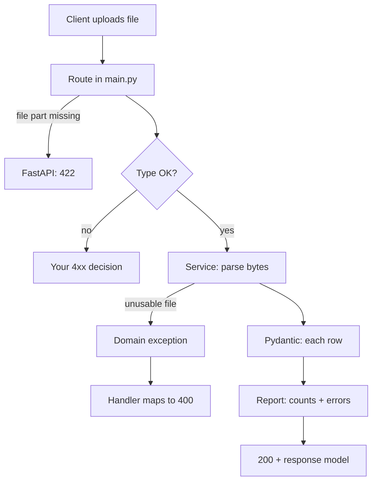

# Concept Kit: Upload, Validate, Report

**Project:** Dataset Readiness API
**Sprint:** A1

Stage 4 compact lesson. It teaches only what A1 needs.

Your A1 code, README, ARCHITECTURE, DECISIONS and demo stay yours. Nothing here is the sprint solution.

Verified on:

- Python 3.12.4
- FastAPI 0.162.0
- Pydantic 2.13.4
- Starlette 1.10.0
- httpx 0.28.1
- python-multipart 0.0.19

This kit connects to what you already know:

- custom exceptions and `try/except`
- generators (Lesson 24)
- `pytest`
- type hints

---

## 1. Objective and success check

**Intent:** Explain and demonstrate how an uploaded file travels from an HTTP request to a validated, structured response, and which layer decides each status code.

You are done with this kit when:

- you answer the 5 retrieval questions in section 6 without notes
- the E1, E2, M1 and H1 suites pass in the `A1-practice` folder

---

## 2. Mental model



How to read it: only the **boundary** (the route and the exception handlers) knows status codes.

The service speaks plain Python. Bytes go in, and a report or an exception comes out.

---

## 3. Why we need Pydantic and FastAPI

This section is the Why-Chain, written as six plain steps.

### The problem

Bad rows in a fine-tuning dataset silently make a model worse.

A client needs to know, before training, exactly which rows are bad and why.

### Why the old way falls short

`json.loads` plus hand-written `if` checks only tells you "it parsed".

Every check is custom code. It is easy to forget one, and the error shape changes from check to check.

### What we need

- A declared schema that validates a record and returns all its problems in a predictable shape.
- A web layer that accepts a file and answers with honest status codes.

### What provides it

- **Pydantic v2** gives you the schema and the validation.
- **FastAPI** gives you routing, `UploadFile`, response models and the generated `/docs` page.

### How it works

1. FastAPI parses the multipart request and hands your function an `UploadFile`.
2. You read its bytes and pass them to plain Python.
3. `Model.model_validate(dict)` returns a model, or raises `ValidationError`.
4. `exc.errors()` is a list of `{type, loc, msg, input, ...}`.
5. `loc` is a path tuple, such as `("instruction",)`. For a row that is not an object it is empty, `()`.
6. A `response_model` makes the response contract a schema, so `/docs` shows the real shape.

### What breaks without it

- Unvalidated input crashes deep in your code and becomes a `500` with a leaked traceback.
- The contract in `/docs` drifts away from reality.
- Every new rule becomes new custom code.

### Left out on purpose

- auth
- Docker
- database
- background tasks
- async concurrency
- dependency injection
- file size limits (a real production concern, so you can list it as deferred in your DECISIONS)

### Decisions that are yours

| Decision | Option A | Option B | What to weigh |
|---|---|---|---|
| How a service signals failure | A domain exception such as `BadUpload`, mapped in `main.py` | Raise `HTTPException` inside the service | A keeps services free of HTTP and easy to test alone. B needs fewer files, but the service now imports FastAPI. |
| Unsupported file type | `415`, as in the brief | `422`, your provisional choice | `415` literally means unsupported media type. `422` is FastAPI's code for a badly shaped request. Either way you must write the check yourself, because FastAPI never looks at file type. |
| Missing `file` part | Accept FastAPI's `422` | Override it with a handler that returns `400` | The override gives one error policy, but `/docs` still advertises `422` unless you document the change. |
| A line in a JSONL file that is not valid JSON | Fail the whole file with `400` | Report it as a bad row | Reporting gives a fuller picture, but what is `field` for a row with no fields? |

---

## 4. Worked example: a books upload

This example uses a different domain from your sprint. It shows the mechanism and is not your solution.

It was run and passes: `5 passed`.

```python
"""Worked example (books domain) - NOT the A1 solution."""
import json

from fastapi import FastAPI, Request, UploadFile
from fastapi.responses import JSONResponse
from fastapi.testclient import TestClient
from pydantic import BaseModel, Field, ValidationError


# --- schemas -----------------------------------------------------------
class Book(BaseModel):
    title: str = Field(min_length=1)
    pages: int = Field(gt=0)
    subtitle: str | None = None


class BookReport(BaseModel):
    total: int
    ok: int


# --- domain exception (knows nothing about HTTP) -----------------------
class BadUpload(Exception):
    def __init__(self, reason: str):
        super().__init__(reason)
        self.reason = reason


# --- service (no FastAPI imports needed to run this) -------------------
def count_valid_books(raw: bytes) -> BookReport:
    try:
        rows = json.loads(raw)
    except (json.JSONDecodeError, UnicodeDecodeError):
        # Bytes that are not text (e.g. a PNG) fail in the *decode* step,
        # before JSON parsing starts, with a different exception type.
        raise BadUpload("not valid JSON")
    if not isinstance(rows, list):
        raise BadUpload("expected a JSON array")
    ok = 0
    for row in rows:
        try:
            Book.model_validate(row)
            ok += 1
        except ValidationError:
            pass
    return BookReport(total=len(rows), ok=ok)


# --- boundary: the only place that knows status codes ------------------
app = FastAPI()


@app.exception_handler(BadUpload)
async def bad_upload_handler(request: Request, exc: BadUpload):
    return JSONResponse(status_code=400, content={"detail": exc.reason})


@app.post("/books/check", response_model=BookReport)
async def check_books(file: UploadFile):
    raw = await file.read()
    return count_valid_books(raw)


# --- boundary tests ----------------------------------------------------
client = TestClient(app)


def _post(content: bytes, name="books.json", ctype="application/json"):
    return client.post("/books/check", files={"file": (name, content, ctype)})


def test_counts():
    body = b'[{"title":"A","pages":10},{"title":"","pages":3},{"title":"C","pages":"x"}]'
    r = _post(body)
    assert r.status_code == 200
    assert r.json() == {"total": 3, "ok": 1}


def test_malformed_is_400():
    r = _post(b"[not json")
    assert r.status_code == 400
    assert r.json() == {"detail": "not valid JSON"}


def test_missing_file_is_422():
    assert client.post("/books/check").status_code == 422


def test_png_is_not_rejected_by_fastapi():
    # FastAPI never checks file type: this is just bad JSON -> our 400.
    assert _post(b"\x89PNG", "a.png", "image/png").status_code == 400


def test_docs_loads():
    assert client.get("/docs").status_code == 200
```

Ask yourself these before moving on:

- Which function never imports FastAPI?
- What happens to `test_png_is_not_rejected_by_fastapi` if you remove `UnicodeDecodeError` from the `except`? (Pitfall 3.)
- Why does `test_counts` pin exact numbers instead of only checking that the numbers add up?
- What would `exc.errors()` contain for the bad rows, and what does this example not do with it? That mapping is exercise E1.

### Tools you will meet

**Packages for A1.** Your `requirements.txt` needs at least:

- `fastapi`
- `pydantic`
- `pytest`
- `python-multipart` (needed for uploads)
- `httpx` (needed for `TestClient`)
- `uvicorn` (to run the demo server)

Pinning versions is your choice. You trade reproducibility against staying current.

**Running the server.** Run `uvicorn <module>:<app-object> --reload` from the repo root. The module path follows your folder layout, and working it out is part of the sprint.

**The `/docs` page.** Open `http://127.0.0.1:8000/docs` in a browser. FastAPI builds it from your routes and models. `/openapi.json` is the machine-readable contract behind it.

**Importing `app` from `tests/`.** `import app` only works if Python can see your repo root. There are three standard ways:

- run `python -m pytest` from the root, which adds the current folder
- keep `__init__.py` files, so pytest's default import mode treats the root as the package base
- set `pythonpath = .` in a `pytest.ini`

Try each one in a scratch folder and watch what happens. Then pick one and record the reason in your DECISIONS.

**A harmless warning.** Starlette 1.10 prints "Using httpx with starlette.testclient is deprecated; install httpx2 instead." It is only a note for now. I could not check the `httpx2` package offline.

**If `TestClient` hangs.** On this machine it hung inside the agent sandbox but worked in a normal terminal. If it hangs for you, suspect the environment before your code.

---

## 5. Pitfalls

### 1. A row is rejected, or "5" is accepted

**Symptom:** a row you expected to pass fails, or you expected a failure that never comes.

**Cause:** Pydantic v2 does not turn an `int` into a `str`, so `response: 5` gives `string_type`. It enforces `min_length`, so `""` gives `string_too_short`. A row that is not an object, such as `5` or `[1]`, gives `model_type` with an empty `loc`.

**Fix:** decide up front what `field` says for a whole-row failure. Test one row of each shape.

### 2. "FastAPI will reject my .png for me"

**Symptom:** you assume bad file types are already handled.

**Cause:** `UploadFile` accepts any bytes. FastAPI's automatic `422` only appears when the request shape is wrong, for example when there is no `file` part.

**Fix:** write the type check yourself, choose the status code, and test it.

### 3. A binary file returns 500

**Symptom:** uploading a PNG crashes with a `500`.

**Cause:** `json.loads(bytes)` decodes the bytes as text first. Bad bytes raise `UnicodeDecodeError`, not `JSONDecodeError`. A handler that only catches the second one lets the first escape as a crash.

**Fix:** catch both, or their shared parent `ValueError`, and add a binary-upload test. E2 and H1 plant this on purpose.

---

## 6. Practice

**Where:** `lessons/project_based_lessons/dataset-readiness-api/A1-practice/`

- `models.py` is provided. Do not edit it.
- Your solutions go in the blank files `e1_flatten.py`, `m1_iter.py` and `e2_app.py`.
- Run each suite from that folder, for example `python -m pytest test_e1.py`.
- Hints stay conceptual (R11).

### E1 [REAL-WORLD]: flatten Pydantic errors

## Intent

**Turn a Pydantic `ValidationError` into a flat list of `{"field", "message"}` dicts, one per problem.**

- Deliverable: `flatten_errors(exc)` in `e1_flatten.py`.
- `field` is the `loc` path joined with `.` into a string. It is an empty string when `loc` is empty.
- `message` is Pydantic's own `msg`, unchanged.
- Return plain `str` values only. No tuples and no extra keys.
- Keep Pydantic's error order.
- Suite: `test_e1.py`.

### E2 [REAL-WORLD]: boundary test for a line counter

## Intent

**Build a tiny FastAPI app that counts the lines of an uploaded text file, answers honestly on errors, and is proven by boundary tests.**

- Deliverable: `app` in `e2_app.py`.
- Route: `POST /count-lines` with a multipart field named `file`.
- Success: `200` with `{"lines": N}`, declared with a Pydantic response model.
- Empty file: `400` with `{"detail": "empty file"}`.
- Bytes that are not UTF-8 text: `400` with `{"detail": "not text"}`, never `500`.
- Missing `file` part: FastAPI's default `422` is expected.
- The counting logic must be a plain function that does not import FastAPI.
- Suite: `test_e2.py`. It needs `httpx` and should run in a normal terminal.

### M1 [REAL-WORLD]: validate lazily, building on generators

## Intent

**Write a generator that pulls rows one at a time and yields only the valid `Product` objects.**

- Deliverable: `iter_valid_products(rows)` in `m1_iter.py`.
- It must be a real generator. Nothing is pulled from `rows` until the first `next()`.
- Invalid and non-object rows are skipped silently.
- Order is preserved, and every yielded item is a `Product`.
- Suite: `test_m1.py`, which includes a laziness check.

### H1 [DEBUG]: three planted bugs

## Intent

**Fix `h1_buggy.py` so `test_h1.py` passes, following the debugging protocol in `notes/DEBUGGING.md`.**

- Three bugs are planted in `check_products`.
- Do not edit the tests or `models.py`.
- The expected results are stated in `test_h1.py`.
- Fill the 7-row Debug Report Chain for each bug as you fix it. Do not jump straight to the fix.
- Hints: ask for level 0 first, which is a question and not the answer.

### Retrieval: 5 questions, no notes

1. A client uploads a `.png` to your endpoint. Which part of the stack rejects it, and what status code is yours to choose?
2. For `{"instruction": "", "response": 5}`, what does Pydantic report? Where do `row`, `field` and `message` in your own response come from?
3. Why is it a design problem if the service raises `HTTPException`, and what are the alternatives?
4. A test asserts `valid + invalid == total`. Name a bug it would not catch, and the test that would.
5. A binary file returns `500`. Where is the missing `except`, and why was it not a `JSONDecodeError`?

---

## Verification evidence

- Worked example: `5 passed`.
- Practice suites run against a reference solution kept outside this repo: `15 passed`.
- Blank deliverables fail on import.
- The buggy `h1_buggy.py` fails all three bug tests.
