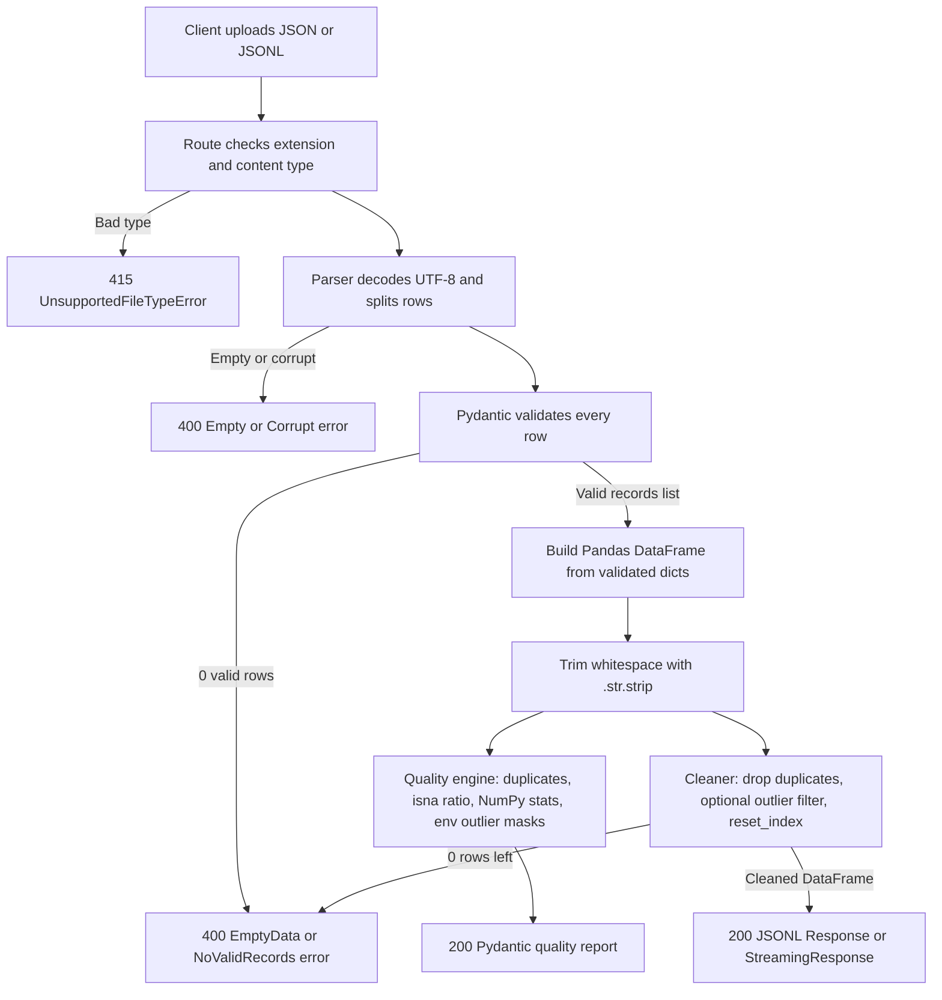

# Concept Kit: Quality Engine and Cleaned Export

**Project:** Dataset Readiness API
**Sprint:** A2

Stage 4 compact lesson. It teaches every NumPy, Pandas, JSONL export, FastAPI download, and environment-config mechanism Sprint A2 needs so you can design, build, test, and document the slice without researching outside the Learning OS.

Each mechanism below is taught as a paired unit: the six-step Why-Chain, when-to-use decision rule, parameter table, standalone runnable worked example, and pitfalls to watch.

Your A2 code, `README.md`, `ARCHITECTURE.md`, `DECISIONS.md`, and `docs/demo.md` stay yours. Every worked example here uses a **Product Reviews** domain (`title`, `body`, `note`), never your LLM dataset validator.

Verified on:

- Python 3.12.4
- pandas 2.2.3
- numpy 1.26.4
- FastAPI 0.162.0
- Pydantic 2.13.4
- httpx 0.28.1

Note on pandas 2.x vs 3.x: if a fresh virtual environment installs pandas 3.x, Copy-on-Write is enabled by default and string columns may use the dedicated `str` dtype instead of `object`. Every pattern taught here (`.copy()` before mutating filtered slices, `.loc[mask, col]`, `.isna()`, `.str.strip()`, `.str.len()`, and casting scalars with `int()`/`float()`) works identically on both pandas 2.x and 3.x.

This kit connects to what you already know:

- Sprint A1 Pydantic models, domain exceptions, and thin FastAPI routes
- `pytest` fixtures, `@pytest.mark.parametrize`, and `monkeypatch` from Lesson 17
- generators (`yield`) from Lesson 24
- JSON parsing and UTF-8 handling from Lesson 11 and Sprint A1

---

## Table of contents

1. [Objective and success check](#1-objective-and-success-check)
2. [Mental model](#2-mental-model)
3. [Why-Chain, decision rules, and worked examples by mechanism](#3-why-chain-decision-rules-and-worked-examples-by-mechanism)
   - [3.1 NumPy arrays, dtypes, and vectorization vs Python loops](#31-numpy-arrays-dtypes-and-vectorization-vs-python-loops)
   - [3.2 NumPy summary statistics, boolean masks, and empty-array traps](#32-numpy-summary-statistics-boolean-masks-and-empty-array-traps)
   - [3.3 Pandas Series and DataFrame creation from validated records](#33-pandas-series-and-dataframe-creation-from-validated-records)
   - [3.4 Indexing with loc, iloc, boolean masks, and copy vs view](#34-indexing-with-loc-iloc-boolean-masks-and-copy-vs-view)
   - [3.5 Missing values with isna, fillna, dropna, and None vs NaN](#35-missing-values-with-isna-fillna-dropna-and-none-vs-nan)
   - [3.6 Vectorized string operations with the str accessor](#36-vectorized-string-operations-with-the-str-accessor)
   - [3.7 Detecting and dropping duplicates with duplicated and drop_duplicates](#37-detecting-and-dropping-duplicates-with-duplicated-and-drop_duplicates)
   - [3.8 Vectorized operations vs iterrows and apply](#38-vectorized-operations-vs-iterrows-and-apply)
   - [3.9 Exporting a DataFrame to JSONL safely](#39-exporting-a-dataframe-to-jsonl-safely)
   - [3.10 FastAPI file download responses and round-trip testing](#310-fastapi-file-download-responses-and-round-trip-testing)
   - [3.11 Typed environment configuration with os.getenv and defaults](#311-typed-environment-configuration-with-osgetenv-and-defaults)
   - [3.12 Architectural decisions that belong to you](#312-architectural-decisions-that-belong-to-you)
4. [Worked examples map](#4-worked-examples-map)
5. [Pitfalls](#5-pitfalls)
6. [Practice and retrieval](#6-practice-and-retrieval)
7. [Sprint slice and exercise coverage matrix](#7-sprint-slice-and-exercise-coverage-matrix)

---

## 1. Objective and success check

**Intent:** Extend your FastAPI service with a Pandas/NumPy quality analysis endpoint and a cleaned JSONL download endpoint—reusing Sprint A1's validation boundary, loading thresholds from environment configuration, and guaranteeing safe native-Python outputs with zero `500` or `NaN` crashes.

You are done with this kit when:

- you answer the 5 retrieval questions in section 6 without notes
- all 17 tests across `test_e1.py`, `test_e2.py`, `test_m1.py`, and `test_h1.py` pass in `A2-practice`
- you finalize your A2 `DECISIONS.md` entries using the decision tables in section 3

---

## 2. Mental model



How to read this diagram:

- **Pydantic runs before Pandas.** Validate every uploaded row with your A1 schema first, then build a `DataFrame` from the clean, typed valid records—never call `pd.read_json` blindly on untrusted upload bytes.
- **Pandas and NumPy stay inside `services/`.** Routes never import `pandas` or `numpy`; they receive validated Pydantic models or JSONL strings/generators from services and return HTTP responses.
- **Native Python leaves the service boundary.** Convert NumPy scalars (`np.int64`, `np.float64`) to plain `int` and `float` before returning models or dicts, and guard empty arrays before calling NumPy reductions.

---

## 3. Why-Chain, decision rules, and worked examples by mechanism

Sprint A2 combines eleven distinct mechanisms. Each subsection below pairs the six-step Why-Chain, decision rule, parameter table, standalone runnable worked example, and pitfalls to watch.

---

### 3.1 NumPy arrays, dtypes, and vectorization vs Python loops

#### Goal

Represent numeric dataset measurements (such as character lengths) in contiguous NumPy arrays with explicit `dtype`s and understand how vectorized operations replace explicit Python loops.

#### Why-Chain

1. **Problem:** To evaluate dataset quality, we need statistics (`min`, `max`, `mean`, `median`) and threshold flags across thousands of text lengths.
2. **Why the old way falls short:** A Python `list[int]` stores pointers to separate heap-allocated `PyObject` integers; looping in Python checks types on every iteration, adds boilerplate for medians/percentiles, and scales slowly on large datasets.
3. **New capability needed:** A homogeneous, contiguous numeric array that stores raw C-level numbers of one fixed type (`int64`, `float64`, `bool`) and executes arithmetic and comparisons in compiled C loops.
4. **Feature that provides it:** `numpy.ndarray` created via `np.array(..., dtype=...)` (or converted from a Pandas Series via `.to_numpy(dtype=np.int64)`).
5. **How it works:** An `ndarray` packs elements back-to-back in memory using a single `dtype` (such as `int64` = 8 bytes per integer). Operations like `lengths * 2` or `lengths > 100` broadcast across the entire buffer in one C call, producing a new array without a Python `for` loop.
6. **What breaks without it:** Hand-rolled loops duplicate standard statistical math, miss edge-case consistency across columns, and leak NumPy scalar types (`np.int64`) into `json.dumps` if you forget to convert results back to Python `int`/`float`.

#### Decision rule: NumPy array vs Python list

| Situation | Choose | Why |
|---|---|---|
| Computing numeric summaries (`mean`, `median`, `percentile`), histograms, or multi-threshold masks across column values | `numpy.ndarray` (`dtype=np.int64` or `np.float64`) | Built-in vectorized math, boolean masks, and C-speed execution. |
| Storing variable-length dicts, Pydantic models, or error objects (`list[RowErrorItem]`) | Plain Python `list` | NumPy is designed for uniform numeric/boolean buffers, not heterogeneous Python objects. |
| Returning scalar counts or ratios inside JSON/Pydantic responses | Cast with `int(...)` / `float(...)` | `json.dumps` rejects `np.int64` with `TypeError` and strict Pydantic fields reject NumPy scalars. |

#### NumPy array construction and dtype reference

| API / Parameter | Example | Result / Type | Common Trap |
|---|---|---|---|
| `np.array(seq, dtype=np.int64)` | `np.array([4, 12, 9], dtype=np.int64)` | 1-D `ndarray`, `dtype('int64')` | Passing `[]` without `dtype=` defaults to `float64`. |
| `arr.dtype` | `lengths.dtype` | `dtype('int64')` | Mixing `int` and `float` silently upcasts the whole array to `float64`. |
| `arr.shape` / `arr.size` | `(3,)` / `3` | Dimensions / total element count | Always check `arr.size == 0` before reductions. |
| `series.to_numpy(dtype=np.int64)` | `df["body"].str.len().to_numpy(dtype=np.int64)` | Clean `int64` array from Pandas | Fails with `ValueError` if the Series contains `NaN` (missing strings). |
| `int(val)` / `float(val)` / `val.item()` | `int(np.int64(7))` | Plain Python `int` | Raw `np.int64(7)` crashes `json.dumps(...)` with `TypeError`. |

#### Worked Example 3.1: NumPy arrays, dtypes, broadcasting, and safe native casting

```python
import json
import numpy as np

reviews = ["ok", "great camera", "battery lasts two days"]
lengths = np.array([len(text) for text in reviews], dtype=np.int64)

assert lengths.dtype == np.int64
assert lengths.shape == (3,)
assert lengths.size == 3

# Broadcasting applies an operation to every element in one step
doubled = lengths * 2
assert doubled.tolist() == [4, 24, 44]

# Raw NumPy scalars fail json.dumps; cast to native Python int/float
raw_total = np.sum(lengths)
assert isinstance(raw_total, np.integer)

try:
    json.dumps({"total_chars": raw_total})
    raise AssertionError("Expected TypeError for np.int64")
except TypeError:
    pass

safe_payload = json.dumps({"total_chars": int(raw_total)})
assert safe_payload == '{"total_chars": 36}'
```

**Pitfalls to watch:** [Pitfall 3 (NumPy scalars in JSON/strict Pydantic)](#3-returning-raw-npint64-or-npfloat64-breaks-jsondumps-and-strict-models).

---

### 3.2 NumPy summary statistics, boolean masks, and empty-array traps

#### Goal

Compute `min`, `max`, `mean`, `median`, and threshold-based outlier counts using NumPy reductions and boolean masks while preventing empty-array crashes and `NaN` serialization failures.

#### Why-Chain

1. **Problem:** Quality reports need both central-tendency length stats (`min`, `max`, `mean`, `median`) and a count of outlier records shorter than `min_len` or longer than `max_len`.
2. **Why the old way falls short:** Writing manual `if/else` counters for every metric mixes length math with boundary conditions, and calling `np.mean([])` or `np.min([])` on an unguarded empty array silently returns `nan` or crashes with `ValueError`.
3. **New capability needed:** Vectorized reduction functions (`np.min`, `np.max`, `np.mean`, `np.median`), compound boolean masks (`|`, `&`, `~`), and an explicit empty-array guard at the start of every stats function.
4. **Feature that provides it:** NumPy statistical reductions + bitwise boolean array operators (`(arr < low) | (arr > high)`) + `int(np.sum(mask))`.
5. **How it works:** Comparing an array against a scalar produces a `bool` array (`[True, False, True]`). Combining two `bool` arrays with `|` (elementwise OR) or `&` (elementwise AND) yields a combined mask; `np.sum(mask)` counts `True` entries because `True == 1` and `False == 0`.
6. **What breaks without it:** Using Python `or` instead of `|` raises `ValueError: The truth value of an array with more than one element is ambiguous`. Passing `np.mean([])` (`float('nan')`) into FastAPI's `JSONResponse` crashes with `ValueError: Out of range float values are not JSON compliant: nan` (`500`).

#### Decision rule: NumPy reductions and masks

- **Use NumPy reductions + boolean masks when:** computing numeric stats (`min`, `max`, `mean`, `median`, `percentile`) or threshold flags over a non-empty numeric array.
- **ALWAYS guard `if lengths.size == 0:` before calling reductions:** raise a domain exception (`EmptyDataError` / `NoValidRecordsError` → `400`) when stats have no valid rows to summarize.
- **NEVER use Python `and`, `or`, `not` on NumPy arrays or Pandas Series:** always use `&`, `|`, `~` with parentheses around each comparison (`(arr < low) | (arr > high)`), because `&` and `|` have higher operator precedence than `<` and `>`.

#### NumPy reductions and mask operations table

| Expression | Input `[2, 5, 10]` | Input `[]` (empty) | Return Type | Notes |
|---|---|---|---|---|
| `np.min(arr)` / `np.max(arr)` | `2` / `10` | Raises `ValueError` | `np.int64` | Always cast via `int(...)`. |
| `np.mean(arr)` | `5.6666...` | `np.float64(nan)` + warning | `np.float64` | `nan` crashes `JSONResponse` (`500`). Cast via `round(float(...), 2)` or `float(...)`. |
| `np.median(arr)` | `5.0` | `np.float64(nan)` + warning | `np.float64` | Even count averages the two middle values. |
| `np.percentile(arr, 95)` | `9.5` | Raises `IndexError` | `np.float64` | Useful for p95 tail-length diagnostics. |
| `(arr < lo) \| (arr > hi)` | `[True, False, False]` | `[]` (`bool`) | `ndarray[bool]` | Parentheses are mandatory around each side. |
| `int(np.sum(mask))` | `1` | `0` | `int` | Counts `True` elements cleanly. |

#### Worked Example 3.2: Summary statistics, outlier masks, and empty-array safety

```python
import numpy as np
from fastapi.responses import JSONResponse


class EmptyMetricError(Exception):
    pass


def summarize_lengths(
    lengths: np.ndarray, min_len: int, max_len: int
) -> dict[str, int | float]:
    if lengths.size == 0:
        raise EmptyMetricError("Cannot compute length stats on 0 rows")

    outlier_mask = (lengths < min_len) | (lengths > max_len)
    return {
        "min": int(np.min(lengths)),
        "max": int(np.max(lengths)),
        "mean": round(float(np.mean(lengths)), 2),
        "median": float(np.median(lengths)),
        "outlier_count": int(np.sum(outlier_mask)),
    }


sample = np.array([2, 5, 10, 25], dtype=np.int64)
report = summarize_lengths(sample, min_len=3, max_len=20)
assert report == {
    "min": 2,
    "max": 25,
    "mean": 10.5,
    "median": 7.5,
    "outlier_count": 2,
}

# Empty input raises our domain error instead of leaking NaN or ValueError
try:
    summarize_lengths(np.array([], dtype=np.int64), min_len=3, max_len=20)
    raise AssertionError("Expected EmptyMetricError")
except EmptyMetricError:
    pass

# Proof that unguarded NaN crashes Starlette/FastAPI JSONResponse
try:
    JSONResponse(content={"mean": float("nan")})
    raise AssertionError("Expected ValueError on NaN JSONResponse")
except ValueError as exc:
    assert "not JSON compliant" in str(exc)
```

**Pitfalls to watch:** [Pitfall 2 (empty array `ValueError` and `NaN` crash)](#2-computing-numpy-stats-on-an-empty-array-crashes-or-leaks-nan), [Pitfall 3 (NumPy scalars in JSON/strict Pydantic)](#3-returning-raw-npint64-or-npfloat64-breaks-jsondumps-and-strict-models), [Pitfall 6 (Python `and`/`or` on Series or arrays)](#6-using-python-and-or-not-on-pandas-series-or-numpy-arrays).

---

### 3.3 Pandas Series and DataFrame creation from validated records

#### Goal

Convert a validated `list[BaseModel]` into a Pandas `DataFrame`, inspect its columns and `Series` types, and understand why Pydantic validation must run *before* Pandas ingestion.

#### Why-Chain

1. **Problem:** After Sprint A1's parser and Pydantic model validate every uploaded row, we have a list of valid `BaseModel` instances that need column-wide trimming, missing-value ratios, deduplication, and length statistics.
2. **Why the old way falls short:** Calling `pd.read_json(raw_bytes)` directly on untrusted uploads bypasses your Pydantic schema—silently coercing integers into strings, crashing inconsistently on malformed JSONL lines, and losing per-row validation counts (`valid` vs `invalid`).
3. **New capability needed:** A clean bridge that validates raw rows through Pydantic first, guards the `0`-valid-rows case, and constructs a typed tabular `DataFrame` from `[record.model_dump() for record in valid_records]`.
4. **Feature that provides it:** `pandas.DataFrame` (table of named columns) and `pandas.Series` (a single labeled column).
5. **How it works:** `record.model_dump()` produces a clean dict with guaranteed keys and validated types (`str` or `None`). `pd.DataFrame(rows)` aligns those keys into columns where every column is a `Series` supporting vectorized `.str`, `.isna()`, and `.duplicated()` operations.
6. **What breaks without it:** Calling `pd.DataFrame([])` on zero valid rows creates a 0-column table where accessing `df["body"]` crashes with `KeyError: 'body'`. Skipping Pydantic before Pandas lets dirty types (`instruction: 123`) skew stats and corrupt exports.

#### Decision rule: `pd.DataFrame([r.model_dump() ...])` vs `pd.read_json(...)`

| Approach | Use when | Do NOT use when |
|---|---|---|
| Validate with A1 parser + Pydantic first, then `pd.DataFrame([r.model_dump() for r in valid_records])` | Untrusted API uploads that require per-row error counts, strict field types, and custom `400` exceptions (Sprint A2). | Huge multi-GB offline batch files where streaming/chunked readers are needed. |
| `pd.read_json(bytes, lines=True)` directly on raw upload | Trusted internal analytics scripts where every row already matches a known schema. | Public APIs where mixed valid/invalid rows must be separated cleanly before analysis. |

#### DataFrame construction and inspection table

| Operation | Purpose | Result on empty `[]` | Watch out for |
|---|---|---|---|
| `pd.DataFrame([r.model_dump() for r in records])` | Build table from validated Pydantic models | 0 rows, **0 columns** | Accessing `df["col"]` raises `KeyError` unless you guard `if not records:` first. |
| `df["body"]` | Access one column as a `Series` | Raises `KeyError` on empty 0-col DF | Returns a `Series`, not a Python `list`. |
| `df.shape` / `len(df)` | `(num_rows, num_cols)` / `num_rows` | `(0, 0)` / `0` | `df.empty` is `True` when `len(df) == 0`. |
| `df.columns.tolist()` | Verify exact column names | `[]` | Column order matches Pydantic field declaration order. |

#### Worked Example 3.3: Building a DataFrame from validated Pydantic records

```python
import pandas as pd
from pydantic import BaseModel, Field


class ReviewRecord(BaseModel):
    title: str = Field(min_length=1, strict=True)
    body: str = Field(min_length=1, strict=True)
    note: str | None = None


class NoValidRowsError(Exception):
    pass


def build_reviews_frame(records: list[ReviewRecord]) -> pd.DataFrame:
    if not records:
        raise NoValidRowsError("No valid records available for analysis")
    return pd.DataFrame([record.model_dump() for record in records])


valid = [
    ReviewRecord(title="Great", body="Solid build quality", note=None),
    ReviewRecord(title="Good", body="Fast shipping", note="verified"),
]
df = build_reviews_frame(valid)

assert df.shape == (2, 3)
assert df.columns.tolist() == ["title", "body", "note"]
assert isinstance(df["body"], pd.Series)

# Guard prevents KeyError on empty DataFrame
try:
    build_reviews_frame([])
    raise AssertionError("Expected NoValidRowsError")
except NoValidRowsError:
    pass
```

**Pitfalls to watch:** [Pitfall 7 (empty `pd.DataFrame([])` causes `KeyError`)](#7-building-pddataframe-without-guarding-empty-validated-rows-causes-keyerror).

---

### 3.4 Indexing with loc, iloc, boolean masks, and copy vs view

#### Goal

Filter and modify rows cleanly using `.loc`, `.iloc`, boolean masks, `.copy()`, and `.reset_index(drop=True)` without hitting chained-assignment bugs or misaligned row labels.

#### Why-Chain

1. **Problem:** Cleaning a dataset requires filtering rows (keeping non-duplicates or in-range lengths) and mutating columns on the filtered result (such as stripping whitespace or assigning flags).
2. **Why the old way falls short:** Writing `subset = df[mask]; subset["title"] = ...` performs *chained indexing*: depending on memory layout and pandas version, `subset` may be a view or a copy, triggering `SettingWithCopyWarning` in pandas 2.x or silently leaving `df` unchanged under pandas 3.x Copy-on-Write. Furthermore, dropping row `1` leaves indices `[0, 2]`, so `cleaned.loc[1]` crashes with `KeyError`.
3. **New capability needed:** Explicit label-based vs position-based selection, explicit `.copy()` when branching off a new DataFrame to mutate, and `.reset_index(drop=True)` after filtering rows.
4. **Feature that provides it:** `df.loc[row_mask, col]` (by label or boolean mask), `df.iloc[pos]` (by integer position), `.copy()`, and `.reset_index(drop=True)`.
5. **How it works:** `.loc[mask, "col"]` performs selection and assignment in a single operation. When you want an independent filtered table, `filtered = df.loc[mask].copy().reset_index(drop=True)` guarantees clean contiguous indices `0..N-1` and safe independent mutations.
6. **What breaks without it:** Chained assignment triggers warnings or silent lost edits; un-reset indices break `.loc[0..n-1]` lookups and cause unexpected index alignment when joining or assigning another Series.

#### Decision rule: `.loc` vs `.iloc` vs `.copy()`

| Task | Use | Avoid |
|---|---|---|
| Filter rows by a boolean mask and select columns | `df.loc[mask, ["title", "body"]]` | `df[mask]["title"] = ...` (chained assignment) |
| Create a new DataFrame you will clean or mutate further | `cleaned = df.loc[mask].copy().reset_index(drop=True)` | Mutating `df[mask]` without `.copy()` |
| Grab the first or last row by 0-based position regardless of index labels | `df.iloc[0]` / `df.iloc[-1]` | `df.loc[0]` after dropping rows without `reset_index(drop=True)` |

#### Indexing and copy semantics table

| Expression | Meaning | Index preserved? | Safe for assignment? |
|---|---|---|---|
| `df.loc[mask]` | Rows where boolean `mask` is `True` | Yes (gaps possible, e.g. `[0, 2]`) | Only after `.copy()` if mutating the result |
| `df.loc[mask, "body"] = ...` | In-place update on matching rows of `df` | Yes | Yes (single indexing step) |
| `df.iloc[0]` | First row by integer position | N/A | Read-only lookup recommended |
| `.copy()` | Independent DataFrame copy | Same index | Yes, zero `SettingWithCopyWarning` |
| `.reset_index(drop=True)` | Replace gapped index `[0, 2]` with `[0, 1]` | Drops old index cleanly | Without `drop=True`, old index becomes a new `"index"` column! |

#### Worked Example 3.4: Boolean filtering, `.loc` vs `.iloc`, `.copy()`, and `reset_index(drop=True)`

```python
import pandas as pd

df = pd.DataFrame([
    {"title": "Short", "body": "no"},
    {"title": "Good", "body": "solid build"},
    {"title": "Great", "body": "works every day"},
])

keep_mask = df["body"].str.len() >= 5

# Safe independent filtered copy with clean 0..N-1 index
cleaned = df.loc[keep_mask].copy().reset_index(drop=True)
cleaned.loc[:, "title"] = cleaned["title"].str.upper()

# Original df is untouched, and cleaned index is contiguous [0, 1]
assert df.loc[1, "title"] == "Good"
assert list(cleaned.index) == [0, 1]
assert cleaned.loc[0, "title"] == "GOOD"
assert cleaned.iloc[-1]["title"] == "GREAT"
assert "index" not in cleaned.columns
```

**Pitfalls to watch:** [Pitfall 8 (mutating a filtered slice without `.copy()`)](#8-mutating-a-filtered-dataframe-slice-without-copy), [Pitfall 10 (forgetting `reset_index(drop=True)`)](#10-missing-download-headers-or-un-reset-dataframe-indices).

---

### 3.5 Missing values with isna, fillna, dropna, and None vs NaN

#### Goal

Detect, count, and handle missing optional values (`None` / `NaN`) reliably using `.isna()`, `.notna()`, `.fillna()`, and `.dropna()` without falling into Python `== None` or `NaN` comparison traps.

#### Why-Chain

1. **Problem:** Optional dataset fields like `note: str | None = None` (or `input: str | None = None` in your project) arrive as `None` on rows where the field was omitted, and the quality report must compute the exact missing ratio (`missing_count / total_valid_rows`).
2. **Why the old way falls short:** In Pandas, `df["note"] == None` does **not** find missing values—it returns `False` for every row! Likewise, IEEE-754 defines `np.nan == np.nan` as `False`.
3. **New capability needed:** Explicit missing-value predicates that treat `None`, `np.nan`, and `pd.NA` uniformly across all dtypes.
4. **Feature that provides it:** `Series.isna()` (alias `.isnull()`), `Series.notna()`, `Series.fillna(...)`, and `DataFrame.dropna(subset=[...])`.
5. **How it works:** `df["note"].isna()` returns a boolean `Series` (`True` wherever a cell is `None`, `np.nan`, or `pd.NA`). Taking `.mean()` on a boolean Series computes the fraction of `True` rows directly (`sum / count`), because `True == 1` and `False == 0`.
6. **What breaks without it:** Using `df["note"] == None` silently reports `missing_ratio = 0.0` even when 100% of rows are missing `note`! And calling `.str.len()` on a nullable text column turns the result into `float64` with `NaN` entries unless filled or filtered first.

#### Decision rule: `.isna()` vs `.fillna()` vs `.dropna()`

| Goal | Use | Why |
|---|---|---|
| Compute missing ratio of an optional field (`note` / `input`) | `float(df["note"].isna().mean())` | Counts `None`, `NaN`, and `pd.NA` accurately in one expression. |
| Keep optional `None` values intact for JSONL export (`{"note": null}`) | Leave as `None` (do **not** `.fillna("")` unless you want empty strings) | Preserves the exact optional schema contract on re-validation. |
| Replace missing values temporarily for a calculation (e.g. length `0` for absent notes) | `df["note"].fillna("").str.len()` | Avoids `NaN` propagating into numeric arrays. |
| Drop rows missing a required column | `df.dropna(subset=["title", "body"])` | Targeted to specific columns so missing optional `note` doesn't delete valid rows. |

#### Missing-value API table

| Method / Check | Behavior on `[None, "ok", np.nan]` | Notes |
|---|---|---|
| `s.isna()` | `[True, False, True]` | Canonical check for all NA sentinels. |
| `s.notna()` | `[False, True, False]` | Logical negation of `.isna()`. |
| `float(s.isna().mean())` | `0.6666...` | Ratio in `[0.0, 1.0]`; guard empty DataFrame first! |
| `s == None` | `[False, False, False]` | **BROKEN** in Pandas—never use `== None` or `== np.nan`. |
| `s.fillna("")` | `["", "ok", ""]` | Returns a new Series; does not mutate `s` in place. |
| `df.dropna(subset=["title"])` | Drops rows where `"title"` is NA only | Calling `df.dropna()` without `subset=` drops rows where optional `note` is `None`! |

#### Worked Example 3.5: Why `== None` fails and how `.isna()` computes missing ratios

```python
import pandas as pd

df = pd.DataFrame([
    {"title": "A", "body": "First review", "note": None},
    {"title": "B", "body": "Second review", "note": "verified"},
    {"title": "C", "body": "Third review", "note": None},
])

# Trap: == None returns False for every row!
broken_check = (df["note"] == None).tolist()  # noqa: E711
assert broken_check == [False, False, False]

# Correct: .isna() detects None and NaN uniformly
missing_mask = df["note"].isna()
assert missing_mask.tolist() == [True, False, True]

missing_ratio = round(float(missing_mask.mean()), 4)
assert missing_ratio == 0.6667

# Watch out: df.dropna() without subset drops rows missing optional note!
assert len(df.dropna()) == 1
assert len(df.dropna(subset=["title", "body"])) == 3
```

**Pitfalls to watch:** [Pitfall 1 (`df["col"] == None` always returns `False`)](#1-comparing-dfcol--none-or-npnan-instead-of-isna).

---

### 3.6 Vectorized string operations with the str accessor

#### Goal

Trim leading/trailing whitespace and measure character lengths across whole DataFrame columns using Pandas' vectorized `.str` accessor, including safe behavior on optional columns containing `None`.

#### Why-Chain

1. **Problem:** Before checking duplicates or measuring character lengths, `"  Great  "` and `"Great"` must be normalized by stripping leading/trailing whitespace, and we need the exact character length of every `title` and `body`.
2. **Why the old way falls short:** Calling `df["title"].strip()` fails with `AttributeError: 'Series' object has no attribute 'strip'`, and looping row-by-row with Python `for` loops to strip optional columns crashes with `AttributeError` when a cell is `None`.
3. **New capability needed:** Elementwise string methods built directly into Pandas `Series` that skip `None`/`NaN` safely without crashing.
4. **Feature that provides it:** The `Series.str` accessor (`df["col"].str.strip()`, `df["col"].str.len()`).
5. **How it works:** `df["col"].str.strip()` applies Python string stripping across every non-null string in the column and preserves `None`/`NaN` untouched. `df["col"].str.len()` returns an integer `Series` (when no nulls exist) or a `float64` `Series` with `NaN` for null cells.
6. **What breaks without it:** Measuring lengths or deduplicating *before* `.str.strip()` causes `"Great"` and `"  Great  "` to look like two different strings with lengths `5` and `9`, corrupting both duplicate counts and length stats.

#### Decision rule: `.str` accessor vs Python string loop

- **Use `df["col"].str.strip()` and `df["col"].str.len()` when:** transforming or measuring a DataFrame text column—especially optional columns where `None` may appear.
- **Normalize with `.str.strip()` BEFORE computing `.str.len()` or `.duplicated()`** so whitespace padding never inflates character lengths or hides duplicates.
- **Note on optional whitespace-only `note`:** If an optional field contains `"   "`, `.str.strip()` turns it into `""` (not `None`); decide whether empty optional strings should stay `""` or be normalized to `None` (`df["note"].replace("", None)`).

#### Common `.str` accessor operations table

| Expression | Input `["  hi ", None, "café"]` | Output | Output dtype note |
|---|---|---|---|
| `s.str.strip()` | `["  hi ", None, "café"]` | `["hi", None, "café"]` | Safely preserves `None`/`NaN`. |
| `s.str.len()` | `["hi", "café"]` (no nulls) | `[2, 4]` | `int64` -> `.to_numpy(dtype=np.int64)` works cleanly. |
| `s.str.len()` | `["hi", None]` (has null) | `[2.0, nan]` | Upcasts to `float64` because `int64` cannot hold `NaN`! |
| `s.str.lower()` | `["Hi", None]` | `["hi", None]` | Useful if you ever want case-insensitive checks. |

#### Worked Example 3.6: Trimming text columns and measuring lengths safely

```python
import numpy as np
import pandas as pd

df = pd.DataFrame([
    {"title": "  Great  ", "body": "  Loved it  ", "note": None},
    {"title": "Okay", "body": "Fine", "note": "  verified  "},
])

# Trim required and optional text columns safely (None stays None)
df["title"] = df["title"].str.strip()
df["body"] = df["body"].str.strip()
df["note"] = df["note"].str.strip()

assert df["title"].tolist() == ["Great", "Okay"]
assert df["body"].tolist() == ["Loved it", "Fine"]
assert pd.isna(df.loc[0, "note"])
assert df.loc[1, "note"] == "verified"

# Required columns have no nulls -> clean int64 NumPy array of lengths
body_lengths = df["body"].str.len().to_numpy(dtype=np.int64)
assert body_lengths.dtype == np.int64
assert body_lengths.tolist() == [8, 4]
```

**Pitfalls to watch:** [Pitfall 5 (deduplicating before trimming whitespace)](#5-deduplicating-or-measuring-lengths-before-trimming-whitespace).

---

### 3.7 Detecting and dropping duplicates with duplicated and drop_duplicates

#### Goal

Count exact duplicate records accurately and remove duplicates deterministically using `DataFrame.duplicated(...)` and `DataFrame.drop_duplicates(...)` with explicit `subset` and `keep` arguments.

#### Why-Chain

1. **Problem:** Real training datasets frequently contain repeated examples (sometimes differing only by extra spaces or an optional note). Training on duplicates biases fine-tuning and leaks eval samples.
2. **Why the old way falls short:** Checking duplicates across *all* columns misses two identical `(title, body)` pairs that differ only in an optional `note` field; conversely, using `keep=False` marks the original row as a duplicate too, over-counting duplicates (`2` instead of `1` for one repeated pair).
3. **New capability needed:** Column-scoped duplicate detection that distinguishes extra copies (`keep="first"`) from all copies (`keep=False`), paired with deterministic deduplication and index reset.
4. **Feature that provides it:** `df.duplicated(subset=[...], keep="first")` and `df.drop_duplicates(subset=[...], keep="first")`.
5. **How it works:** Pandas hashes each row's tuple of values in `subset` in top-to-bottom order. With `keep="first"`, the first time a key appears it is marked `False` (keep), and every subsequent identical key is marked `True` (duplicate). `int(mask.sum())` equals the exact number of rows that `drop_duplicates(subset=..., keep="first")` removes!
6. **What breaks without it:** Using `keep=False` makes `duplicate_count` disagree with `len(before) - len(after)`. Calling `drop_duplicates()` without `subset=` fails to collapse duplicates that differ only in optional metadata. Calling it *before* `.str.strip()` misses whitespace duplicates.

#### Decision rule: `keep="first"` vs `keep="last"` vs `keep=False`

| `keep` value | Marks on `[A, A, A, B]` | `mask.sum()` | `drop_duplicates` keeps | When to use |
|---|---|---|---|---|
| `keep="first"` (default) | `[False, True, True, False]` | `2` | 1st `A`, `B` (2 rows) | Standard dataset cleaning: keep earliest copy, count extra duplicates (`removed == duplicate_count`). |
| `keep="last"` | `[True, True, False, False]` | `2` | 3rd `A`, `B` (2 rows) | Append-only logs where newer rows supersede older entries. |
| `keep=False` | `[True, True, True, False]` | `3` | `B` only (1 row) | Only when any duplicated key is considered tainted and ALL copies must be discarded. |

#### Worked Example 3.7: Trim-then-deduplicate and `keep="first"` vs `keep=False`

```python
import pandas as pd

df = pd.DataFrame([
    {"title": "  Great  ", "body": "Loved it", "note": "first"},
    {"title": "Great", "body": "  Loved it ", "note": "second"},
    {"title": "Great", "body": "Loved it", "note": "third"},
    {"title": "Okay", "body": "Decent", "note": None},
])

# Step 1: Trim before deduplicating so whitespace copies match
df["title"] = df["title"].str.strip()
df["body"] = df["body"].str.strip()

# Step 2: keep="first" counts extra copies (2), matching rows removed
dup_first = df.duplicated(subset=["title", "body"], keep="first")
assert dup_first.tolist() == [False, True, True, False]
assert int(dup_first.sum()) == 2

# Contrast: keep=False flags ALL 3 copies (including the first!)
dup_all = df.duplicated(subset=["title", "body"], keep=False)
assert int(dup_all.sum()) == 3

# Step 3: Drop duplicates and reset index to contiguous 0..N-1
cleaned = (
    df.drop_duplicates(subset=["title", "body"], keep="first")
    .copy()
    .reset_index(drop=True)
)
assert len(cleaned) == 2
assert len(df) - len(cleaned) == int(dup_first.sum())
assert cleaned.loc[0, "note"] == "first"
assert list(cleaned.index) == [0, 1]
```

**Pitfalls to watch:** [Pitfall 4 (`keep=False` over-counts duplicates)](#4-using-keepfalse-instead-of-keepfirst-when-counting-extra-duplicates), [Pitfall 5 (deduplicating before trimming whitespace)](#5-deduplicating-or-measuring-lengths-before-trimming-whitespace).

---

### 3.8 Vectorized operations vs iterrows and apply

#### Goal

Choose vectorized Pandas/NumPy operations over `df.iterrows()` and `df.apply(axis=1)` for column-wide transformations and understand when row iteration is still justified.

#### Why-Chain

1. **Problem:** Beginners moving from Python loops to Pandas instinctively write `for idx, row in df.iterrows(): ...` or `df.apply(lambda r: ..., axis=1)` to compute lengths, trim text, or flag outliers.
2. **Why the old way falls short:** `df.iterrows()` constructs a brand-new Pandas `Series` object for *every single row* in Python, throwing away Pandas' columnar layout and running 10x–100x slower than vectorized `.str` and NumPy mask operations. `df.apply(..., axis=1)` is also a Python loop under the hood.
3. **New capability needed:** A clear rule distinguishing column-wide vectorized operations (fast, idiomatic, concise) from cases where pure Python iteration over dicts/tuples is genuinely cleaner.
4. **Feature that provides it:** Columnar `.str` methods, boolean masks (`(lengths < lo) | (lengths > hi)`), and `df.to_dict(orient="records")` / `df.itertuples()` when Python objects are truly required.
5. **How it works:** Vectorized calls operate once per column rather than once per row. For example, computing `lengths = df["body"].str.len()` + `(lengths < 5) | (lengths > 100)` executes in milliseconds on tens of thousands of rows without allocating per-row `Series` objects.
6. **What breaks without it:** Using `iterrows()` inside an API endpoint slows down larger uploads dramatically, invites mutation bugs (modifying `row` returned by `iterrows()` does **not** reliably update `df`), and violates idiomatic Pandas practice.

#### Decision rule: Vectorized vs `apply` vs `iterrows` vs `to_dict`

| Need | Choose | Why |
|---|---|---|
| Trimming strings, measuring lengths, comparing thresholds, counting NAs or duplicates | **Vectorized** (`.str.strip()`, `.str.len()`, boolean masks, `.isna()`, `.duplicated()`) | Fastest, shortest, zero per-row `Series` overhead. |
| Calling a complex external Python function or Pydantic model on each row | Plain Python over `df.to_dict(orient="records")` or `df.itertuples(index=False)` | Faster and cleaner than `iterrows()`, with real Python objects. |
| Per-row custom logic with `df.iterrows()` or `df.apply(axis=1)` | **Avoid in A2** | Both loop in Python while paying heavy Pandas `Series` construction overhead per row. |

#### Worked Example 3.8: Vectorized outlier flagging vs `iterrows` parity and timing check

```python
import time
import numpy as np
import pandas as pd

# Build 2,000 synthetic review rows
df = pd.DataFrame({
    "body": ["short" if i % 5 == 0 else "normal length review" for i in range(2000)]
})

# Vectorized approach (idiomatic Pandas + NumPy)
t0 = time.perf_counter()
lengths = df["body"].str.len().to_numpy(dtype=np.int64)
vec_outliers = int(np.sum((lengths < 6) | (lengths > 100)))
t_vec = time.perf_counter() - t0

# Slow iterrows approach (anti-pattern for column math)
t1 = time.perf_counter()
loop_outliers = 0
for _, row in df.iterrows():
    n = len(row["body"])
    if n < 6 or n > 100:
        loop_outliers += 1
t_iter = time.perf_counter() - t1

assert vec_outliers == loop_outliers == 400
assert t_vec < t_iter  # Vectorized is markedly faster even on 2,000 rows
```

**Pitfalls to watch:** [Pitfall 6 (Python `and`/`or` on Series or arrays)](#6-using-python-and-or-not-on-pandas-series-or-numpy-arrays).

---

### 3.9 Exporting a DataFrame to JSONL safely

#### Goal

Serialize a cleaned Pandas `DataFrame` back into valid UTF-8 JSON Lines (`.jsonl`) where `None`/`NaN` become JSON `null` and non-ASCII characters survive intact.

#### Why-Chain

1. **Problem:** `POST /datasets/clean` must return a `.jsonl` file whose every line is one valid JSON object that passes Sprint A1's `POST /datasets/validate` with `invalid == 0`.
2. **Why the old way falls short:** Calling `df.to_json()` with no arguments exports a column-oriented JSON object (`{"title":{"0":"Great"}}`), not JSONL! Even with `orient="records", lines=True`, default `force_ascii=True` escapes `"café"` into `"\u00e9"`. Meanwhile, manually running `json.dumps` on `df.to_dict(orient="records")` breaks with `ValueError` if any numeric column contains Python `float("nan")`.
3. **New capability needed:** Line-delimited JSON serialization that outputs one clean record per line, maps `None`/`NaN` to JSON `null`, and preserves UTF-8 text.
4. **Feature that provides it:** `df.to_json(orient="records", lines=True, force_ascii=False)` (in-memory string) or a generator yielding `json.dumps(..., ensure_ascii=False, allow_nan=False) + "\n"` after normalizing `NaN` to `None`.
5. **How it works:** `orient="records"` formats each row as `{"col": value, ...}`, `lines=True` separates records by `\n` (with no enclosing `[...]`), and `force_ascii=False` writes literal UTF-8 characters (`"café"`). Pandas automatically converts `None` and `NaN` cells to JSON `null`.
6. **What breaks without it:** Missing `orient="records"` or `lines=True` breaks JSONL parsers; forgetting `force_ascii=False` mangles multilingual text; serializing raw `NaN` produces non-standard `NaN` tokens that fail strict JSON parsers or raise `ValueError`.

#### Decision rule: `df.to_json(...)` vs generator with `json.dumps`

| Approach | Choose when | Watch out for |
|---|---|---|
| `df.to_json(orient="records", lines=True, force_ascii=False)` | Dataset fits comfortably in memory (typical A2 upload) and you want one concise, null-safe call. | Always pass `orient="records"`, `lines=True`, and `force_ascii=False`. |
| Generator yielding `json.dumps(clean_row, ensure_ascii=False, allow_nan=False) + "\n"` | Streaming large cleaned exports row-by-row with `StreamingResponse` (Lesson 24 transfer). | Replace any `NaN` with `None` (`df.astype(object).where(pd.notna(df), None)`) before `to_dict(orient="records")`. |

#### JSONL export parameter table

| Option | Effect | Default | Recommended for A2 |
|---|---|---|---|
| `orient="records"` | One JSON object per row | `"columns"` | Mandatory |
| `lines=True` | Newline-delimited JSONL (no outer `[...]`) | `False` | Mandatory |
| `force_ascii=False` | Keep UTF-8 characters (`"café"`) | `True` (escapes `\uXXXX`) | Strongly recommended |
| `allow_nan=False` (in `json.dumps`) | Fail loudly instead of emitting invalid JSON `NaN` | `True` | Mandatory if using `json.dumps` |

#### Worked Example 3.9: Exporting cleaned DataFrame to JSONL and proving round-trip validity

```python
import json
import pandas as pd
from pydantic import BaseModel, Field


class ReviewRecord(BaseModel):
    title: str = Field(min_length=1, strict=True)
    body: str = Field(min_length=1, strict=True)
    note: str | None = None


cleaned = pd.DataFrame([
    {"title": "Café Blend", "body": "Smooth roast", "note": None},
    {"title": "Green Tea", "body": "Fresh aroma", "note": "organic"},
])

jsonl_text = cleaned.to_json(orient="records", lines=True, force_ascii=False)
lines = [line for line in jsonl_text.splitlines() if line.strip()]

assert len(lines) == 2
assert "Café Blend" in lines[0]
assert '"note":null' in lines[0]

# Round-trip proof: every exported line parses as JSON and passes Pydantic
parsed_models = [ReviewRecord.model_validate(json.loads(line)) for line in lines]
assert len(parsed_models) == 2
assert parsed_models[0].note is None
assert parsed_models[1].note == "organic"
```

**Pitfalls to watch:** [Pitfall 9 (`force_ascii=True` or raw `NaN` in `to_dict`)](#9-exporting-jsonl-with-force_asciitrue-or-raw-nan-values).

---

### 3.10 FastAPI file download responses and round-trip testing

#### Goal

Return a downloadable `.jsonl` file from a FastAPI route using `Response` or `StreamingResponse` with accurate `media_type`, `Content-Disposition`, and OpenAPI documentation, and verify it end-to-end with `TestClient`.

#### Why-Chain

1. **Problem:** Unlike `POST /datasets/validate` and `POST /datasets/quality` (which return JSON objects via `response_model`), `POST /datasets/clean` must return a raw `.jsonl` file that `curl -o cleaned.jsonl` or a browser saves directly as a file.
2. **Why the old way falls short:** Returning a plain Python `str` from a FastAPI route wraps it in JSON quotes (`"{\"title\":\"...\"}\n"` with `Content-Type: application/json`), turning your JSONL file into a double-escaped JSON string!
3. **New capability needed:** Returning raw text/bytes with `Content-Type: application/x-ndjson` and `Content-Disposition: attachment; filename="cleaned.jsonl"` while keeping `400`/`415` error handlers returning JSON.
4. **Feature that provides it:** `fastapi.responses.Response` (for an already-built JSONL string) or `fastapi.responses.StreamingResponse` (for a lazy generator yielding lines), paired with `responses={200: {"content": {"application/x-ndjson": {}}}}` for `/docs`.
5. **How it works:** `Response(content=jsonl_text, media_type="application/x-ndjson", headers={"Content-Disposition": 'attachment; filename="cleaned.jsonl"'})` writes the exact UTF-8 bytes directly as the HTTP body with no extra JSON encoding. `StreamingResponse(iter_lines(), ...)` pulls chunks lazily from a generator so memory stays bounded.
6. **What breaks without it:** Returning a `str` double-encodes JSONL into an invalid JSON string; omitting `Content-Disposition` stops browsers and some HTTP clients from treating the response as a downloadable file; leaving `response_model` set on a `Response` route raises a FastAPI validation error or shows the wrong schema in `/docs`.

#### Decision rule: `Response` vs `StreamingResponse`

| Choice | Use when | Trade-off |
|---|---|---|
| `Response(content=jsonl_text, media_type=..., headers=...)` | The cleaned DataFrame is already in memory and `df.to_json(...)` produced the string in one step. | Simplest, sets `Content-Length` automatically; holds output string in RAM. |
| `StreamingResponse(line_generator, media_type=..., headers=...)` | You want to stream lines incrementally from a generator (`yield`) without assembling one big output string. | Lower peak memory for large exports; errors raised *after* streaming starts cannot switch HTTP status code (so validate & check `df.empty` *before* returning `StreamingResponse`!). |

#### File response parameter table

| Argument / Header | Value for JSONL | Purpose |
|---|---|---|
| `media_type` | `"application/x-ndjson"` (or `"application/jsonl"`) | Tells clients the body is newline-delimited JSON, not a single JSON document. |
| `Content-Disposition` | `'attachment; filename="cleaned.jsonl"'` | Prompts download with a default filename. |
| `response_class=Response` (on route decorator) | Prevents FastAPI from trying to serialize the return value as JSON | Keeps `/docs` clean alongside `responses={200: ..., 400: ..., 415: ...}`. |

#### Worked Example 3.10: FastAPI JSONL download route + `TestClient` round-trip check

```python
import json
import pandas as pd
from fastapi import FastAPI, File, UploadFile
from fastapi.responses import Response
from fastapi.testclient import TestClient

app_dl = FastAPI()


@app_dl.post(
    "/reviews/clean",
    response_class=Response,
    responses={
        200: {
            "description": "Cleaned JSONL download",
            "content": {"application/x-ndjson": {}},
        }
    },
)
async def download_cleaned(file: UploadFile = File(...)) -> Response:
    raw = await file.read()
    rows = [json.loads(line) for line in raw.decode("utf-8-sig").splitlines() if line.strip()]
    df = pd.DataFrame(rows)
    df["title"] = df["title"].str.strip()
    df = df.drop_duplicates(subset=["title", "body"], keep="first")
    jsonl_body = df.to_json(orient="records", lines=True, force_ascii=False)
    return Response(
        content=jsonl_body,
        media_type="application/x-ndjson",
        headers={"Content-Disposition": 'attachment; filename="cleaned.jsonl"'},
    )


client = TestClient(app_dl)
upload = (
    b'{"title": "  Great  ", "body": "Loved it"}\n'
    b'{"title": "Great", "body": "Loved it"}\n'
)
resp = client.post(
    "/reviews/clean",
    files={"file": ("reviews.jsonl", upload, "application/octet-stream")},
)

assert resp.status_code == 200
assert resp.headers["content-type"].startswith("application/x-ndjson")
assert 'filename="cleaned.jsonl"' in resp.headers["content-disposition"]
lines = [json.loads(line) for line in resp.text.splitlines() if line.strip()]
assert lines == [{"title": "Great", "body": "Loved it"}]
```

**Pitfalls to watch:** [Pitfall 10 (missing `Content-Disposition` or `media_type`)](#10-missing-download-headers-or-un-reset-dataframe-indices).

---

### 3.11 Typed environment configuration with os.getenv and defaults

#### Goal

Read quality thresholds (such as minimum and maximum character lengths) from environment variables documented in `.env.example` with safe typed defaults and validation—without adding extra third-party dependencies.

#### Why-Chain

1. **Problem:** Sprint A2's outlier thresholds (e.g., `MIN_TEXT_LENGTH`, `MAX_TEXT_LENGTH`) vary by model and dataset. Hardcoding `5` and `4000` inside `dataset_analyzer.py` forces code edits every time thresholds change, while `.env.example` stays empty and unused.
2. **Why the old way falls short:** Reading raw `os.environ["MAX_LEN"]` crashes with `KeyError` on a clean checkout where `.env` does not exist; reading `os.getenv("MAX_LEN")` without converting or validating returns a `str` (causing `TypeError` when compared against `int`) or lets `min_len > max_len` silently pass.
3. **New capability needed:** A small pure-Python config loader in `app/core/config.py` that reads `os.getenv(key, default)`, parses integers/floats into a Pydantic `BaseModel` (validating bounds like `min_len >= 1` and `max_len >= min_len`), and is easy to override in tests via `pytest`'s `monkeypatch.setenv`.
4. **Feature that provides it:** `os.getenv(...)` + a Pydantic `BaseModel` (with `@model_validator(mode="after")` from A1!) called per-request or via a small helper function `get_settings()`.
5. **How it works:** Calling `get_settings()` reads the current environment with safe defaults matching `.env.example`. Because `get_settings()` reads `os.getenv` when called (instead of freezing globals once at import time), `monkeypatch.setenv(...)` in `pytest` works cleanly with zero module-reloading hacks!
6. **What breaks without it:** Caching `MAX_LEN = int(os.getenv(...))` at module import time means `monkeypatch.setenv` inside a test has **no effect** after `app.main` was imported! And committing a real `.env` file risks leaking secrets later.

#### Decision rule: `get_settings()` helper vs import-time constants vs `pydantic-settings`

| Approach | Choose when | Why |
|---|---|---|
| `get_settings() -> AppSettings` using `os.getenv` + Pydantic `BaseModel` | Stage 4 A2 (`Tool Sync` safe, zero extra packages) | Testable with `monkeypatch.setenv`, validates `min <= max`, defaults work on clean checkout. |
| Module-level `MAX_LEN = int(os.getenv(...))` | Only if you never override env vars dynamically in tests | Freezes values at import time, making `monkeypatch.setenv` silently ignored! |
| `pydantic-settings` (`BaseSettings`) | Only if explicitly added to `requirements.txt` and taught | Not required for 2–4 numeric thresholds in A2. |

#### Environment config pattern table

| Key in `.env.example` | Code lookup | Type & Check | Clean-checkout behavior |
|---|---|---|---|
| `MIN_INSTRUCTION_LENGTH=5` | `int(os.getenv("MIN_INSTRUCTION_LENGTH", "5"))` | `int`, `ge=1` | Uses `5` if `.env` is absent |
| `MAX_INSTRUCTION_LENGTH=2000` | `int(os.getenv("MAX_INSTRUCTION_LENGTH", "2000"))` | `int`, `ge=min` | Uses `2000` if `.env` is absent |
| `MIN_RESPONSE_LENGTH=5` | `int(os.getenv("MIN_RESPONSE_LENGTH", "5"))` | `int`, `ge=1` | Uses `5` if `.env` is absent |
| `MAX_RESPONSE_LENGTH=4000` | `int(os.getenv("MAX_RESPONSE_LENGTH", "4000"))` | `int`, `ge=min` | Uses `4000` if `.env` is absent |

*(Note: exact variable names and default numbers in `.env.example` are yours to choose in `dataset-readiness-api`.)*

#### Worked Example 3.11: Typed env settings with defaults and dynamic test override

```python
import os
from pydantic import BaseModel, Field, model_validator


class ReviewSettings(BaseModel):
    min_body_len: int = Field(ge=1)
    max_body_len: int = Field(ge=1)

    @model_validator(mode="after")
    def check_bounds(self) -> "ReviewSettings":
        if self.min_body_len > self.max_body_len:
            raise ValueError("min_body_len must be <= max_body_len")
        return self


def get_settings() -> ReviewSettings:
    return ReviewSettings(
        min_body_len=int(os.getenv("REVIEW_MIN_BODY_LEN", "5")),
        max_body_len=int(os.getenv("REVIEW_MAX_BODY_LEN", "500")),
    )


# Works with zero env vars set (clean checkout default)
os.environ.pop("REVIEW_MIN_BODY_LEN", None)
os.environ.pop("REVIEW_MAX_BODY_LEN", None)
default_cfg = get_settings()
assert default_cfg.min_body_len == 5
assert default_cfg.max_body_len == 500

# Dynamically reflects env changes (just like pytest monkeypatch.setenv)
os.environ["REVIEW_MIN_BODY_LEN"] = "10"
os.environ["REVIEW_MAX_BODY_LEN"] = "100"
try:
    custom_cfg = get_settings()
    assert (custom_cfg.min_body_len, custom_cfg.max_body_len) == (10, 100)
finally:
    os.environ.pop("REVIEW_MIN_BODY_LEN", None)
    os.environ.pop("REVIEW_MAX_BODY_LEN", None)
```

**Pitfalls to watch:** Freezing `os.getenv(...)` at import time breaks `monkeypatch.setenv` in tests; always read inside `get_settings()` (or accept an optional settings argument in service functions).

---

### 3.12 Architectural decisions that belong to you

Every row below is a real design choice for your `DECISIONS.md` in `dataset-readiness-api`. The kit teaches the mechanisms and trade-offs; you pick the policy and record *why*.

| Decision | Options | Trade-off to weigh |
|---|---|---|
| **1. Sharing validation between `/validate`, `/quality`, `/clean`** | **(A)** Separate validator functions vs **(B)** One `validate_dataset(raw_bytes, ext)` returning an internal result object `(summary: DatasetSummarySchema, valid_records: list[DatasetRecord])` (no boolean flag needed!) | **(B)** avoids both code duplication *and* mode-flag branching: `/validate` returns `result.summary`, while `/quality` and `/clean` use both `result.summary` (counts) and `result.valid_records` (for Pandas). |
| **2. Length stats shape in `/quality` response** | **(A)** Nested Pydantic sub-model `LengthStats(min, max, mean, median)` used twice: `instruction_length: LengthStats` and `response_length: LengthStats` vs **(B)** 8 flat fields (`instruction_min_len`, ...) | **(A)** is much cleaner in OpenAPI `/docs`, avoids 8 repetitive field names, and reuses one `LengthStats` schema cleanly. |
| **3. Duplicate `keep` policy & key** | `subset=["instruction", "response"]` with `keep="first"` vs `keep="last"` vs `keep=False` | `keep="first"` preserves earliest example and ensures `duplicate_count == rows_dropped`. |
| **4. Should `/clean` drop outlier rows or keep them?** | **(A)** Drop invalid + duplicates + length outliers vs **(B)** Drop invalid + duplicates only (report outliers in `/quality` without deleting them in `/clean`) | **(A)** produces a strictly bounded dataset matching your env thresholds; **(B)** avoids silently deleting valid long domain answers. Pick one and test it! |
| **5. Rule-based readiness verdict** | **(A)** 2-tier (`"ready"` vs `"needs_cleaning"`) vs **(B)** 3-tier (`"ready"` / `"needs_cleaning"` / `"not_ready"`) | State the exact boolean rule in `DECISIONS.md` and write tests proving each verdict branch. |
| **6. `0` valid rows or `0` clean rows left** | Raise `EmptyFileError` (`400`) vs dedicated `NoValidRecordsError` (`400`) | Both return honest `400` JSON (never `500` or `NaN`), while a dedicated exception makes the `error` code and `detail` message clearer to clients. |
| **7. JSONL export response type** | `Response(content=...)` vs `StreamingResponse(generator)` | `Response` is simpler with `df.to_json(...)`; `StreamingResponse` streams row-by-row for larger uploads (remember: check `df.empty` *before* returning the stream). |

---

## 4. Worked examples map

Every standalone worked example in section 3 runs independently in its own Python process (using the **Product Reviews** domain):

| Example | Paired Concept Subsection | Key Mechanism Proven |
|---|---|---|
| `Worked Example 3.1` | [3.1 NumPy arrays and dtypes](#31-numpy-arrays-dtypes-and-vectorization-vs-python-loops) | `np.array(..., dtype=np.int64)`, broadcasting, `int()` casting for `json.dumps` |
| `Worked Example 3.2` | [3.2 NumPy stats and empty-array traps](#32-numpy-summary-statistics-boolean-masks-and-empty-array-traps) | `min`/`max`/`mean`/`median`, `(a < lo) \| (a > hi)` mask, `EmptyMetricError` guard, `JSONResponse(NaN)` failure |
| `Worked Example 3.3` | [3.3 DataFrame from validated records](#33-pandas-series-and-dataframe-creation-from-validated-records) | `pd.DataFrame([r.model_dump() ...])` after Pydantic + empty list guard |
| `Worked Example 3.4` | [3.4 Indexing and copy vs view](#34-indexing-with-loc-iloc-boolean-masks-and-copy-vs-view) | `.loc`, `.iloc`, `.copy()`, `.reset_index(drop=True)` |
| `Worked Example 3.5` | [3.5 Missing values and None vs NaN](#35-missing-values-with-isna-fillna-dropna-and-none-vs-nan) | Why `== None` fails, `.isna().mean()`, targeted `dropna(subset=...)` |
| `Worked Example 3.6` | [3.6 Vectorized str operations](#36-vectorized-string-operations-with-the-str-accessor) | `.str.strip()` preserving `None`, `.str.len().to_numpy(dtype=np.int64)` |
| `Worked Example 3.7` | [3.7 Detecting and dropping duplicates](#37-detecting-and-dropping-duplicates-with-duplicated-and-drop_duplicates) | Trim-then-dedupe, `keep="first"` vs `keep=False`, `reset_index(drop=True)` |
| `Worked Example 3.8` | [3.8 Vectorized vs iterrows and apply](#38-vectorized-operations-vs-iterrows-and-apply) | Identical result + faster runtime for vectorized masks vs `iterrows()` |
| `Worked Example 3.9` | [3.9 Exporting DataFrame to JSONL](#39-exporting-a-dataframe-to-jsonl-safely) | `to_json(orient="records", lines=True, force_ascii=False)` + Pydantic round-trip |
| `Worked Example 3.10` | [3.10 FastAPI file download responses](#310-fastapi-file-download-responses-and-round-trip-testing) | `Response(..., media_type="application/x-ndjson", Content-Disposition)` + `TestClient` |
| `Worked Example 3.11` | [3.11 Typed env config with os.getenv](#311-typed-environment-configuration-with-osgetenv-and-defaults) | `get_settings()` reading `os.getenv` dynamically + `@model_validator` bounds check |

---

## 5. Pitfalls

### 1. Comparing `df["col"] == None` or `np.nan` instead of `.isna()`

**Symptom:** `missing_input_ratio` always returns `0.0` even when half the records have `input: None`.

**Cause:** In Pandas, `Series == None` evaluates to `False` for every element, and IEEE-754 defines `np.nan == np.nan` as `False`.

**Fix:** Always detect missing values with `df["col"].isna()` (or `df["col"].notna()`), and compute the missing ratio with `float(df["col"].isna().mean())`.

---

### 2. Computing NumPy stats on an empty array crashes or leaks `NaN`

**Symptom:** Uploading a file where all rows fail validation returns `500 Internal Server Error` (`ValueError: zero-size array...` or `ValueError: Out of range float values are not JSON compliant: nan`).

**Cause:** `np.min([])` / `np.max([])` raise `ValueError`, while `np.mean([])` / `np.median([])` return `nan`, which Starlette's `JSONResponse` refuses to serialize.

**Fix:** Guard `if not valid_records:` (or `if lengths.size == 0:`) *before* calling any NumPy reduction, and raise a domain exception mapped to `400`.

---

### 3. Returning raw `np.int64` or `np.float64` breaks `json.dumps` and strict models

**Symptom:** `TypeError: Object of type int64 is not JSON serializable` or Pydantic `int_type` validation failure when strict mode is enabled.

**Cause:** NumPy reductions and Pandas `.sum()` return `np.int64` / `np.float64` scalar objects, not native Python `int` / `float`.

**Fix:** Explicitly wrap scalar outputs with `int(...)` and `float(...)` before placing them into Pydantic models or dicts.

---

### 4. Using `keep=False` instead of `keep="first"` when counting extra duplicates

**Symptom:** A dataset with 2 identical rows reports `duplicate_count: 2` instead of `1`, and `valid - duplicate_count` does not match the cleaned row count.

**Cause:** `df.duplicated(subset=..., keep=False)` marks *all* copies (including the first kept record) as `True`.

**Fix:** Use `keep="first"` in both `duplicated(...)` and `drop_duplicates(...)` so `duplicate_count` equals the exact number of redundant rows removed.

---

### 5. Deduplicating or measuring lengths before trimming whitespace

**Symptom:** `"What is Python?"` and `"  What is Python?  "` are treated as two distinct records with different character lengths (`15` vs `19`).

**Cause:** Running `.duplicated()` or `.str.len()` before `.str.strip()`.

**Fix:** Normalize string columns with `.str.strip()` immediately after building the DataFrame, *before* duplicate checks, length stats, and outlier checks.

---

### 6. Using Python `and`, `or`, `not` on Pandas Series or NumPy arrays

**Symptom:** `ValueError: The truth value of a Series is ambiguous. Use a.empty, a.bool(), a.item(), a.any() or a.all().`

**Cause:** Writing `(lengths < min_len) or (lengths > max_len)` uses Python's scalar boolean `or`, which cannot evaluate a multi-element array.

**Fix:** Use elementwise bitwise operators `&`, `|`, `~` with parentheses around every condition: `(lengths < min_len) | (lengths > max_len)`.

---

### 7. Building `pd.DataFrame([])` without guarding empty validated rows causes `KeyError`

**Symptom:** Accessing `df["instruction"]` crashes with `KeyError: 'instruction'` (`500`) when a file has `0` valid rows.

**Cause:** `pd.DataFrame([])` creates an empty table with zero columns.

**Fix:** Check `if not valid_records: raise EmptyDataError(...)` *before* constructing the DataFrame.

---

### 8. Mutating a filtered DataFrame slice without `.copy()`

**Symptom:** Pandas emits `SettingWithCopyWarning`, or an update on a filtered DataFrame silently fails to apply under Copy-on-Write.

**Cause:** Filtering with `sub = df[mask]` and then mutating `sub["col"] = ...` performs chained indexing on a slice.

**Fix:** Chain `.copy()` whenever creating a new DataFrame you will modify (`cleaned = df.loc[mask].copy().reset_index(drop=True)`), or assign in one step via `df.loc[mask, "col"] = ...`.

---

### 9. Exporting JSONL with `force_ascii=True` or raw `NaN` values

**Symptom:** Non-ASCII text like `"café"` turns into `"\u00e9"`, or manual `json.dumps` emits non-standard `NaN` tokens (or crashes with `allow_nan=False`).

**Cause:** `DataFrame.to_json` defaults to `force_ascii=True`, and `df.to_dict(orient="records")` keeps Python `float("nan")` inside float columns.

**Fix:** Use `df.to_json(orient="records", lines=True, force_ascii=False)`—or if using a `json.dumps` generator, convert `NaN` to `None` first and pass `ensure_ascii=False, allow_nan=False`.

---

### 10. Missing download headers or un-reset DataFrame indices

**Symptom:** `POST /datasets/clean` returns a double-quoted JSON string (`"{\"instruction\":...}"`), clients don't recognize it as a `.jsonl` attachment, or `.loc[0]` fails with `KeyError` after dropping row `0`.

**Cause:** Returning a plain `str` from a FastAPI route instead of `Response` / `StreamingResponse`, omitting `Content-Disposition`, or forgetting `.reset_index(drop=True)` after dropping rows.

**Fix:** Return `Response(content=..., media_type="application/x-ndjson", headers={"Content-Disposition": 'attachment; filename="cleaned.jsonl"'})` (or `StreamingResponse`), and call `.reset_index(drop=True)` after `drop_duplicates` / row filtering.

---

## 6. Practice and retrieval

**Where:** `lessons/project_based_lessons/dataset-readiness-api/A2-practice/`

- `models.py` is **PROVIDED**. Do not edit it.
- Your solutions go in the blank files `e1_stats.py`, `e2_clean.py`, and `m1_export_app.py`, plus fixing the 3 planted bugs in `h1_buggy.py`.
- Run each suite from that folder, for example:
  `python -m pytest test_e1.py`
- Hints stay conceptual only (`RULES.md` R11).

---

### E1 `[REAL-WORLD]`: NumPy length statistics and outlier counter

## Intent

**Compute character-length statistics (`min`, `max`, `mean`, `median`) and threshold outlier counts using NumPy arrays and boolean masks, returning native Python types and guarding empty input.**

- Deliverable file: `e1_stats.py`
- Deliverable symbols imported by `test_e1.py`: `compute_length_stats`, `count_outliers`
- Provided symbols to import from `models.py`: `EmptyDataError`, `LengthStats`
- Rules for `compute_length_stats(values: list[str]) -> LengthStats`:
  - If `values` is empty (`not values`), raise `EmptyDataError`.
  - Build a NumPy `int64` array of character lengths (`len(v)` for each string).
  - Return `LengthStats(min=..., max=..., mean=..., median=...)` where `min` and `max` are native Python `int`, `mean` is `round(float(np.mean(...)), 2)`, and `median` is `float(np.median(...))`.
- Rules for `count_outliers(values: list[str], min_len: int, max_len: int) -> int`:
  - If `values` is empty, return `0`.
  - Count strings whose length is strictly less than `min_len` OR strictly greater than `max_len` (inclusive bounds `[min_len, max_len]` are NOT outliers) using a NumPy boolean mask, and return a native Python `int`.
- Pitfalls to watch: [Pitfall 2](#2-computing-numpy-stats-on-an-empty-array-crashes-or-leaks-nan), [Pitfall 3](#3-returning-raw-npint64-or-npfloat64-breaks-jsondumps-and-strict-models), [Pitfall 6](#6-using-python-and-or-not-on-pandas-series-or-numpy-arrays).
- Suite: `test_e1.py`

---

### E2 `[REAL-WORLD]`: Pandas trimming, deduplication, and missing-ratio engine

## Intent

**Build a pure Pandas service function that trims text fields, computes missing optional-field ratio and exact duplicate count, removes duplicates deterministically, and resets the index.**

- Deliverable file: `e2_clean.py`
- Deliverable symbol imported by `test_e2.py`: `clean_reviews`
- Provided symbols to import from `models.py`: `EmptyDataError`, `ReviewRecord`
- Rules for `clean_reviews(records: list[ReviewRecord]) -> tuple[pd.DataFrame, int, float]`:
  - If `records` is empty, raise `EmptyDataError`.
  - Build a `DataFrame` from `[r.model_dump() for r in records]`.
  - Strip whitespace from `title`, `body`, and `note` using `.str.strip()` (preserving `None` in `note`).
  - Compute `missing_note_ratio` across all input `records` using `float(df["note"].isna().mean())`.
  - Compute `duplicate_count` as a native Python `int` using `df.duplicated(subset=["title", "body"], keep="first").sum()`.
  - Drop duplicates on `subset=["title", "body"]` with `keep="first"`, copy, and reset index (`drop=True`).
  - Return `(cleaned_df, duplicate_count, missing_note_ratio)`.
- Pitfalls to watch: [Pitfall 1](#1-comparing-dfcol--none-or-npnan-instead-of-isna), [Pitfall 4](#4-using-keepfalse-instead-of-keepfirst-when-counting-extra-duplicates), [Pitfall 5](#5-deduplicating-or-measuring-lengths-before-trimming-whitespace), [Pitfall 7](#7-building-pddataframe-without-guarding-empty-validated-rows-causes-keyerror), [Pitfall 8](#8-mutating-a-filtered-dataframe-slice-without-copy).
- Suite: `test_e2.py`

---

### M1 `[REAL-WORLD]`: Env-configured JSONL cleaning and download endpoint

## Intent

**Load length thresholds from environment variables, export a cleaned DataFrame to UTF-8 JSONL, and serve it through a FastAPI download endpoint that returns `400` when zero rows survive.**

- Deliverable file: `m1_export_app.py`
- Deliverable symbols imported by `test_m1.py`: `load_limits`, `export_jsonl`, `app`
- Provided symbols to import from `models.py`: `EmptyDataError`, `ReviewRecord`
- Rules for `load_limits() -> tuple[int, int]`:
  - Read `MIN_BODY_LEN` (default `"5"`) and `MAX_BODY_LEN` (default `"200"`) via `os.getenv`, returning `(min_len, max_len)` as `int`s dynamically on each call.
- Rules for `export_jsonl(df: pd.DataFrame) -> str`:
  - Export `df` to newline-delimited JSON with UTF-8 preserved (`force_ascii=False`) and `None`/`NaN` serialized as JSON `null`.
- Rules for `app` (`FastAPI` instance):
  - Register `@app.exception_handler(EmptyDataError)` returning status `400` with `{"detail": str(exc)}`.
  - Route `POST /reviews/clean` accepting `file: UploadFile = File(...)` (JSONL upload):
    - Decode UTF-8-sig, parse non-blank lines, keep only lines that parse as JSON and validate against `ReviewRecord`. If none are valid, raise `EmptyDataError`.
    - Trim `title`, `body`, `note`; drop duplicates on `["title", "body"]` (`keep="first"`).
    - Filter rows to keep only `min_len <= len(body) <= max_len` using `load_limits()`. If zero rows remain, raise `EmptyDataError`.
    - Return `Response(content=export_jsonl(df), media_type="application/x-ndjson", headers={"Content-Disposition": 'attachment; filename="cleaned_reviews.jsonl"'})`.
- Pitfalls to watch: [Pitfall 9](#9-exporting-jsonl-with-force_asciitrue-or-raw-nan-values), [Pitfall 10](#10-missing-download-headers-or-un-reset-dataframe-indices).
- Suite: `test_m1.py`

---

### H1 `[DEBUG]`: Three planted bugs in `h1_buggy.py`

## Intent

**Diagnose and fix three planted bugs in `h1_buggy.py` so `test_h1.py` passes, following the 7-row Debug Report Chain (`notes/DEBUGGING.md`).**

- Deliverable file: `h1_buggy.py` (contains `analyze_reviews(records: list[ReviewRecord], min_len: int, max_len: int) -> dict`)
- Deliverable symbol imported by `test_h1.py`: `analyze_reviews`
- Do not edit `test_h1.py` or `models.py`.
- Fill the 7-row Debug Report Chain (`Symptom`, `Trigger`, `Hypothesis`, `Evidence`, `Cause`, `Fix`, `Proof`) for each of the 3 bugs as you fix them.
- Pitfalls to watch: [Pitfall 1](#1-comparing-dfcol--none-or-npnan-instead-of-isna), [Pitfall 2](#2-computing-numpy-stats-on-an-empty-array-crashes-or-leaks-nan), [Pitfall 4](#4-using-keepfalse-instead-of-keepfirst-when-counting-extra-duplicates).
- Suite: `test_h1.py`

---

### Retrieval: 5 questions, no notes

Answer these 5 questions in chat before starting the A2 implementation:

1. **NumPy Empty & Scalar Traps:** What happens if you call `np.min([])`, `np.mean([])`, and pass `np.mean([])` or `np.int64(5)` directly into FastAPI `JSONResponse` / `json.dumps`? How do you prevent all three?
2. **Pydantic Before Pandas & Missing Values:** Why should Pydantic validation run *before* building a Pandas `DataFrame` from uploaded files, and why does `(df["input"] == None).mean()` return `0.0` even when rows have `input: None`?
3. **Deduplication & Ordering:** Why must `.str.strip()` run *before* `duplicated(...)` and `.str.len()`, and what is the difference between `duplicated(subset=[...], keep="first")` and `keep=False` when reporting `duplicate_count`?
4. **Vectorization & Copy-vs-View:** Why should A2 avoid `df.iterrows()` for length/outlier math, why does `(lengths < min_len) or (lengths > max_len)` crash, and why do we chain `.copy().reset_index(drop=True)` after filtering a DataFrame?
5. **JSONL Download & Env Config:** Why does returning a plain `str` from `POST /datasets/clean` break JSONL downloads (what must you return instead, with which headers), and why should `get_settings()` read `os.getenv(...)` inside a function instead of freezing constants at module import time?

---

## 7. Sprint slice and exercise coverage matrix

Every requirement in the Sprint A2 Brief (`projects/stage-4-setup/A2.md`) and every exercise in `A2-practice/` maps to an explicit Concept Kit section and verified worked example below:

| Requirement (Sprint A2 Brief or Exercise) | Construct, API, or Mechanism Needed | Taught in Kit Section | Verified Worked Example / `PROVIDED` |
|---|---|---|---|
| **Brief:** Load validated rows into a Pandas `DataFrame` (Pydantic before Pandas) | `pd.DataFrame([r.model_dump() for r in valid_records])`, empty-list guard | Section 3.3 + Pitfall 7 | Worked Example 3.3 |
| **Brief:** Trim whitespace on text columns before dedupe/lengths | `Series.str.strip()`, `Series.str.len()` | Section 3.6 + Pitfall 5 | Worked Example 3.6 |
| **Brief:** Exact duplicate detection & counting on trimmed `(instruction, response)` | `df.duplicated(subset=[...], keep="first")`, `df.drop_duplicates(...)`, `reset_index(drop=True)` | Sections 3.4, 3.7 + Pitfalls 4, 5, 8 | Worked Examples 3.4, 3.7 |
| **Brief:** Missing optional `input` ratio | `df["input"].isna().mean()`, `None` vs `NaN` handling | Section 3.5 + Pitfall 1 | Worked Example 3.5 |
| **Brief:** NumPy character-length stats (`min`, `max`, `mean`, `median`) & native types | `np.array(..., dtype=np.int64)`, `np.min`/`max`/`mean`/`median`, `int()`/`float()` cast, empty guard | Sections 3.1, 3.2 + Pitfalls 2, 3 | Worked Examples 3.1, 3.2 |
| **Brief:** Length outlier count via vectorized boolean masks | `(lengths < lo) \| (lengths > hi)`, `int(np.sum(mask))`, vectorized vs `iterrows` | Sections 3.2, 3.8 + Pitfall 6 | Worked Examples 3.2, 3.8 |
| **Brief:** Outlier thresholds from env vars documented in `.env.example` | `os.getenv(...)`, Pydantic `BaseModel` settings + `@model_validator`, `monkeypatch.setenv` | Section 3.11 | Worked Example 3.11 |
| **Brief:** Export cleaned JSONL that re-validates cleanly (`invalid == 0`) | `df.to_json(orient="records", lines=True, force_ascii=False)` / null-safe `json.dumps` | Section 3.9 + Pitfall 9 | Worked Example 3.9 |
| **Brief:** `POST /datasets/clean` downloadable file response + OpenAPI docs | `Response` / `StreamingResponse`, `media_type="application/x-ndjson"`, `Content-Disposition`, `responses={...}` | Section 3.10 + Pitfall 10 | Worked Example 3.10 |
| **Brief:** `400` on `0` valid/clean rows, no `500` or `NaN` crashes, A2 decisions | Domain exception (`EmptyDataError` / `NoValidRecordsError`), decision trade-off matrix | Sections 3.2, 3.3, 3.12 + Pitfalls 2, 7 | Worked Examples 3.2, 3.3 (Learner drafts `DECISIONS.md` per R18) |
| **Exercise `E1`** (`compute_length_stats`, `count_outliers`) | `np.array`, `np.min`/`max`/`mean`/`median`, boolean mask, `int`/`float` cast, empty guard | Sections 3.1, 3.2 + Pitfalls 2, 3, 6 | Worked Examples 3.1, 3.2 + `models.py` (`PROVIDED`) |
| **Exercise `E2`** (`clean_reviews`) | `pd.DataFrame`, `.str.strip()`, `.isna().mean()`, `duplicated(keep="first")`, `drop_duplicates`, `.copy().reset_index(drop=True)` | Sections 3.3, 3.4, 3.5, 3.6, 3.7 + Pitfalls 1, 4, 5, 7, 8 | Worked Examples 3.3, 3.4, 3.5, 3.6, 3.7 + `models.py` (`PROVIDED`) |
| **Exercise `M1`** (`load_limits`, `export_jsonl`, `app`) | `os.getenv`, `to_json(orient="records", lines=True, force_ascii=False)`, `Response`, `Content-Disposition`, `EmptyDataError` handler, `TestClient` | Sections 3.9, 3.10, 3.11 + Pitfalls 9, 10 | Worked Examples 3.9, 3.10, 3.11 + `models.py` (`PROVIDED`) |
| **Exercise `H1-[DEBUG]`** (`analyze_reviews` 3 bugs) | `.isna()` vs `== None`, `keep="first"` vs `keep=False`, empty-records guard before DataFrame/NumPy | Sections 3.2, 3.3, 3.5, 3.7 + Pitfalls 1, 2, 4, 7 | Worked Examples 3.2, 3.3, 3.5, 3.7 + `h1_buggy.py` (`PROVIDED`) |

---

## Verification evidence

- All 11 standalone worked examples in section 3 run independently in isolated Python processes with exit code 0 and all asserts passing.
- Practice suites (`test_e1.py`, `test_e2.py`, `test_m1.py`, `test_h1.py`) against reference solutions kept outside the repo (`scratch/ref_a2/`): `17 passed in 1.13s`.
- Vacuous-test check on `A2-practice/`: blank `e1_stats.py`, `e2_clean.py`, and `m1_export_app.py` fail collection with `ImportError`; `h1_buggy.py` fails all 3 bug tests (`3 failed, 1 passed`).
- Matrix check: every section (`3.1`–`3.12`), worked example (`3.1`–`3.11`), and pitfall (`1`–`10`) named in section 7 exists in this file, and every symbol imported by `test_e1.py`–`test_h1.py` is named in its exercise spec.
- Runtime facts verified on Python 3.12.4 / pandas 2.2.3 / numpy 1.26.4 / FastAPI 0.162.0: `df["note"] == None` returns all `False`; `np.min([])` raises `ValueError`; `np.mean([])` returns `nan`; `JSONResponse({"mean": float("nan")})` raises `ValueError: Out of range float values are not JSON compliant: nan`; `json.dumps({"n": np.int64(5)})` raises `TypeError`; `(s < 5) or (s > 100)` raises `ValueError: The truth value of a Series is ambiguous`; `to_json(orient="records", lines=True, force_ascii=False)` preserves UTF-8 and writes `null`.
